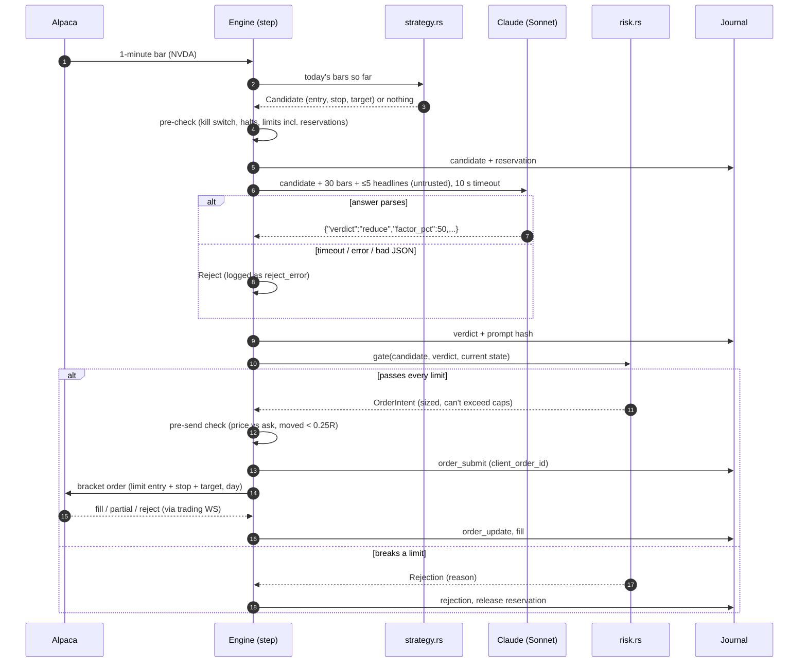

# bmv-trader — System Design

Status: draft v3 · 2026-11-02 · Current phase: **P1 (gate pending), P2 in progress**
See also: [DECISION.md](DECISION.md) (key decisions and why) · [FLOW.md](FLOW.md) (how the flow runs, who decides).
v3 incorporates 4 independent reviews (architecture, silent failures, type design, trading/broker fact-check). Alpaca facts are checked against docs.alpaca.markets as of 2026-11-02; anything marked **[verify]** must be tested in paper during P2 before code relies on it.

## 1. Goal

An AI-assisted intraday trading system for US stocks/ETFs (crypto later), running on a Mac during market hours.
Deterministic rules find setups, Claude vets them, hard-coded risk limits have the final say. Paper trading by default.
**The real goal is to find and prove an edge cheaply.** Every phase is gated, and failing a gate means stopping or going back.

**Non-goals (v1):** options, futures, overnight holds, 24/7 crypto, high-frequency trading, any UI that can place orders, cloud deployment.

**Monitoring:**
- Alpaca's dashboard for positions, orders and P&L (from day one)
- the terminal log plus `status` and `report` commands (P3)
- `watch` (terminal) and the `ui` web console on 127.0.0.1 (P3, DECISION S16): session state, account, positions, orders, journal and trials, with STOP and flatten as the only controls
- in P4 the console adds candidates, Claude's verdicts and Claude vs shadow; Tailscale access would be a new decision
- phone alerts (P5)

No UI ever has buy or sell buttons. The only controls are STOP and flatten.

## 2. Decisions

| Topic | Decision |
|---|---|
| Broker / data | Alpaca. Basic (free) plan: IEX real-time, websocket ≤ 30 symbols, 200 historical calls/min. IEX minute history starts late July 2020 (measured: none on 2020-07-15, present on 2020-07-27), so research uses 2020-08-03 on |
| Language | Rust, single binary |
| AI role | Rules generate candidates → Claude approves, reduces, or rejects → risk gate decides |
| Execution | Automatic in paper. In live, each order needs your confirmation (phone), plus a confirmation at the start of each live session. |
| Hours | Regular hours only. Every phase time comes from Alpaca's calendar/clock (half-days handled); flat 5 minutes before close. |
| Risk (paper) | $25k notional · ≤$2,500 per position · ≤1% ($250) risk per trade · daily halt at −2% ($500) · ≤5 positions · total open risk ≤ remaining daily budget |
| Money | Integer cents (`i64` newtypes); whole shares only |
| Free models (OmniRoute) | Never in the decision path. Summaries only, added after the P4 gate. |
| Claude (direct API) | Trade vetting. No fallback: any failure rejects the trade. |

## 3. Core principles

> **LLMs propose, code disposes.** **The broker is the source of truth.** **Unknown means stop.**

- **Claude can only shrink a trade.** It approves, rejects, or reduces by a percentage from 1 to 99. Its answer type has no field for symbol, side, stop or quantity, so the type system rules out the rest.
- Every model output is parsed strictly: unknown fields are rejected and nothing gets a default value. If it doesn't parse, it's a reject.
- News text is untrusted. It's delimited, length-capped, and logged raw next to each decision.
- Risk limits are plain Rust with unit tests. The only way to build an `OrderIntent` is `risk::gate()`, and the only way to place an order is `broker.submit_bracket(OrderIntent)`.
- **Positions, orders, fills and today's P&L always come from Alpaca.** The journal is an audit log and is never used to rebuild trading state.
- Any state the system can't confirm — stale data, a failed journal write, an unknown position, an order whose outcome is unknown, a kill-switch read error — means **no new entries** until it's resolved.

## 4. Architecture

```
            ┌────────────────────────────── bmv-trader engine (one process, tokio) ──────────────────────────────┐
 Alpaca     │                                                                                                   │
 market WS ─┼─► Bar / Status(halt, LULD) ──┐                                                                    │
 trading WS ┼─► TradeUpdate ───────────────┤                                                                    │
 REST snap ─┼─► Reconciled ────────────────┼──► inbox (mpsc) ──► ENGINE TASK: step(&mut State, Event) -> Effects │
 1 s timer ─┼─► Tick (STOP, staleness) ────┤                         │ sole owner of State                      │
 CLI ───────┼─► Command (flatten) ─────────┤                         ▼                                          │
            │  VetResult ◄── Claude task ◄─┴──── Effect::Vet / SubmitBracket / Cancel / Journal / Alert          │
            │                                    (spawned; result comes back as an Event)                       │
            └───────────────────────────────────────────────────────────────────────────────────────────────────┘
 Separate processes:  flatten-backstop (launchd timer at close−3 min) · watchdog (off-host dead-man check)
 Research:  history + backtest drive the SAME step() with a replay feeder and a simulated broker
```

### Diagrams (render on GitHub / VS Code with Mermaid)

**Architecture.** Arrows into the engine are events; arrows out are effects. The AI only answers when the engine asks.


**One candidate.** Every arrow from the AI goes back through the engine and the risk gate. Nothing reaches Alpaca without them.



### Concurrency and state model
- **One engine task owns `State`** (open positions and working orders mirrored from Alpaca, reservations, counters, halts). No shared mutexes.
- Everything that happens arrives as an `Event` on one inbox. Everything the engine wants done goes out as an `Effect`. Network effects run in spawned tasks, and their results come back as events.
- **The core is pure: `step(&mut State, Event) -> Vec<Effect>`.** The backtest and the live engine run this exact function, so the two paths can't drift apart.
- **Reservations:** from the moment a candidate is sent to Claude until its order fills or is cancelled, it counts against every limit (positions, notional, open risk, clusters, trades/day). The risk gate runs again on the current state when the verdict comes back, and again after a live approval.
- **Journal before act:** an effect is written to the journal before it is executed. If the write fails, the engine halts entries.
- **On startup and after any reconnect:** take a REST snapshot of positions, open orders and today's fills, then emit `Reconciled`, which replaces all broker-owned state.

## 5. Components → files

| Module | Responsibility |
|---|---|
| `config.rs` ✅ | `.env` → `Config` (fields private, secret redacted in `Debug`, base URL derived from `Mode`); fails on a `.env` parse error; reports which source set `TRADING_MODE` |
| `money.rs` | `Usd(i64)` cents, `Price(i64)` cents > 0, `Qty(NonZeroU32)`; parse from Alpaca's string fields; exact integer arithmetic |
| `broker.rs` ✅ | Alpaca REST with timeouts (5 s connect, 10 s total); typed responses (`Account`, `Position`, `Order`); `submit_bracket(OrderIntent)`, `cancel`, `close_all` — **no generic POST** |
| `market_data.rs` | Websocket with `feed=iex`: bars, `updatedBars`, `statuses`, `lulds`; ping/pong deadline; per-symbol staleness; REST backfill |
| `history.rs` | Download historical 1-minute bars with an explicit `feed=` and the feed recorded; throttled below 200 calls/min; resumable |
| `strategy.rs` | Pure: bars → `Candidate::long(...)` (validates stop < entry < target, minimum R) |
| `vetting.rs` | Prompt build + strict parse → `Decision { verdict: Approve / Reduce(Factor) / Reject, rationale }`; `parse()` can't fail: any error becomes a Reject |
| `risk.rs` | `Limits::for_mode(Mode)`, `gate(&Candidate, &Decision, &State, &Limits) -> Result<OrderIntent, Rejection>`; startup self-test |
| `engine.rs` | `State`, `Event`, `Effect`, `step()`; used by both live and backtest |
| `backtest.rs` | Replay feeder + simulated broker (§13 fill model) + metrics |
| `journal.rs` | SQLite `events` table (append-only); reports are SQL views |
| `llm.rs` | `claude()`: Anthropic host hard-coded, checks the response's model id, timeout, fails closed. `cheap()` (OmniRoute): separate client, runs detached, never awaited on the trading path |
| `main.rs` | CLI: `account`, `fetch`, `backtest`, `run`, `flatten`, `report` |

Crates to add, each only when its step needs it: `tokio`, `tokio-tungstenite`, `rusqlite`, `serde` (derive), `chrono` + `chrono-tz`.

## 6. Trading day

All times come from Alpaca's `/v2/calendar` (today's open and close) and `/v2/clock`, never fixed local times. If the local clock differs from Alpaca's timestamp by more than 2 seconds, the system refuses to trade. If a timer fires late (for example after the Mac wakes), it catches up from the clock.

| When | Phase | What happens |
|---|---|---|
| open − 30 min | Startup | Config check, risk-gate self-test, kill-switch self-test, reconcile with Alpaca, in live the session confirmation. Any failure means no trading today. |
| open → open + 15 min | Opening range | Bars stamped `open … open+14m` (a bar's `t` is its start time); no trades |
| open + 15 → close − 30 min | Trading | Candidates on 1-minute bar close → reserve → vet → gate → submit |
| close − 30 min | No new entries | Cancel any unfilled entry orders |
| close − 5 min | Flatten | `close_all` (positions with `cancel_orders=true`) **[verify]**, then poll positions until empty, retrying. Alert if not flat by close − 2 min. |
| close − 3 min | Backstop | A separate launchd job runs `bmv-trader flatten`, independent of the engine's state |
| after close | Review | Daily summary; journal backup |

On a half-day (close at 13:00), all of this shifts automatically.

## 7. Strategy v1: Opening Range Breakout (ORB-15)

- **Universe:** see §13 (rule-based). For P3/P4 live trading: a fixed list of 10 liquid names (SPY, QQQ, AAPL, MSFT, NVDA, AMD, META, AMZN, GOOGL, TSLA). That's within the 30-symbol websocket limit.
- **Indicators use regular-hours bars of the current day only:** no premarket bars and no previous day. The opening range needs **at least 10 of its 15 bars** (IEX skips quiet minutes). Any bar that isn't sane (non-finite or ≤ 0 price, low/high not bracketing open/close, out of order, before the open) means no candidate that day for that symbol.
- **Long entry:** the **first** bar after the opening range whose close is above the opening-range high, with volume above the average of the earlier bars today. If that first close above fails the volume filter, the day is done for that symbol, and a later re-break doesn't fire either.
- **ATR(14):** a simple average of the last 14 true ranges, using today's bars only (the first bar's previous close is not yesterday's). Prices are converted to cents with the entry rounded up and the stop rounded down, so rounding never understates R.
- **Stop:** the opening-range low or entry − 1.5 × ATR, whichever is closer to entry. **Minimum R = max(0.15% of price, 5¢).** If R is smaller, there's no trade.
- **Target:** 2R. Exit at flatten time regardless.
- **Size** (in `risk.rs`, not the strategy): `qty = min(risk_per_trade / R, max_position / entry)` in integer cents. If qty < 1, no trade. `Candidate` carries prices only.
- **One trade per symbol per day**, derived from today's Alpaca orders via the `client_order_id` prefix
- **Optional trend filter (`--trend`, its own trial):** a breakout is taken only while both SPY and the symbol trend **up** today: last close above today's VWAP and above today's first open. Too few bars, bad bars, no volume or missing SPY bars mean "can't tell", so no trade. The random baseline uses the same filter, so the comparison still isolates the entry signal.
- **Shorts:** off in v1

## 7b. Trial 4: gap-and-go (pre-registered 2026-11-03, before any run)

- **Universe, exits, sizing, costs, fill model:** as ORB (§7, §13). Long only.
- **Yesterday's close:** the last regular-hours close of the previous loaded day. This is the one exception to "today's bars only". A symbol with no bars that day has no close, so no trade. Only the backtest provides it (`Event::PrevClose`); `run` stays ORB-only.
- **Gap:** today's first bar opens **at least +1.0%** above yesterday's close.
- **Entry:** the ORB rule over a **5-minute range (at least 3 bars)**. The first close above the range high, on volume above today's average so far, with the close still above yesterday's close (gap not filled).
- **Stop:** the closer of the 5-minute range low and entry − 1.5 × ATR. ATR uses today's bars so far: up to 14 true ranges, and at least 4.
- **Target:** 2R.
- No parameter search: these values are fixed before the first run.

## 7c. Trial 5: VWAP pullback (pre-registered 2026-11-03, before any run)

- **Universe, exits, sizing, costs, fill model:** as ORB. Long only.
- **Warm-up:** no signal before **10:00 ET**, and at least 20 bars in the first 30 minutes.
- **Signal bar**, which must be the **first** bar of the day to meet all of these:
  - it closes above today's running VWAP (typical price × volume)
  - it closes above today's first open (day trending up)
  - it closes above the previous bar's high (the move resumed)
  - one of the 3 bars before it had a low at or below VWAP at that time (it pulled back to VWAP)
- **Stop:** the closer of the 3-bar pullback low and entry − 1.5 × ATR(14).
- **Target:** 2R.
- No parameter search.

**Both trials count toward the gate.** With trials 1–3, that makes 5 trials, and the Bonferroni correction applies to all of them. Neither gets a `--trend` or `--marketable` variant unless that is pre-registered as a further trial.

## 8. Decision pipeline (one candidate)

1. **Strategy** emits a `Candidate`, which is journaled.
2. **Pre-check** (deterministic; Claude isn't called if it fails):
   - kill switch
   - halts and staleness for the symbol, and an active trading halt or LULD pause on it
   - max positions, the symbol's correlation cluster, and open risk, all counted including reservations
   - Claude call cap and Claude error streak
   If it passes, **reserve** the slot.
3. **Vet:** Claude gets the fixed system prompt (cached), the candidate, the last 30 bars, and up to 5 headlines inside `<untrusted_news>` tags, each with its `created_at`. (Free-plan news may lag 15 minutes **[verify]**.) It returns strict JSON.
   - A timeout (10 s), an API error or a schema failure count as a **reject**, journaled as `reject_error` and kept separate from verdict rejects.
   - **5 errors in a row stops vetting for the day and sends an alert.** Since every trade needs Claude's verdict, that also means no new entries.
4. **Risk gate** runs again on the current state and enforces every rule in §9. The result is an `OrderIntent` or a `Rejection`, and the reservation is released if it's rejected.
5. **Pre-send check:** the limit price must be within 0.2% of the current ask, stop < entry < target, and qty × price ≤ the notional cap. If the price has moved more than 0.25R since the candidate, it's a reject.
6. **Live only:** a phone approval tied to a one-time token for this order id. After "yes", steps 4–5 run again. No answer within 60 s, or any other answer, cancels it.
7. **Broker:**
   - Submit a **bracket** order: limit entry, `time_in_force=day`, `extended_hours=false`, with a deterministic `client_order_id = bmv-{date}-{symbol}-{seq}`. Alpaca keeps this field unique.
   - A submit error means the outcome is **unknown**, not failed. Reconcile by `client_order_id` before doing anything else.
   - **Entry time-to-live = 1 bar.** If the entry isn't filled, cancel it.
   - **Partial fill:** Alpaca activates the bracket legs only when the entry is *completely* filled. So cancel the rest of the entry and immediately submit an OCO (stop + target) for the filled quantity, or close it **[verify OCO]**.
   - The OCO's client id is the entry id plus `-x`. **If Alpaca refuses the OCO** (for example the price is already below the stop), close that position immediately with `close_position`.
   - `close_all` / `close_position` returning Ok means the close was **accepted**, not that the account is flat: confirm with `positions()`.
   - **Both legs filled** (Alpaca warns this can happen in fast markets): the minute-by-minute reconcile detects the unexpected short and closes it.
8. **Journal** records every step: the decision, the order id, the fills and the outcome.

## 9. Risk rules (hard limits, `risk.rs`)

| Rule | Paper | Live (initial) |
|---|---|---|
| Max notional per position | $2,500 | $500 |
| Max risk per trade, (entry − stop) × qty | $250 | $50 |
| Max open positions (including reservations and working entries) | 5 | 2 |
| **Total open risk ≤ remaining daily loss budget** | yes | yes |
| **Correlation clusters:** index {SPY, QQQ} · semis {NVDA, AMD} · mega-cap tech {AAPL, MSFT, META, AMZN, GOOGL} · {TSLA} | ≤ 2 per cluster | ≤ 1 per cluster |
| Daily loss halt: **Alpaca `equity − last_equity`** | −$500 | −$100 |
| Max new trades per day (from today's Alpaca orders) | 10 | 3 |
| Max Claude calls per day | 30 | 10 |
| Consecutive-loss halt | 3 | 2 |
| Minimum R | 0.15% of price, 5¢ | same |
| Account restrictions | Read Alpaca's account flags (`trading_blocked`, buying power) and block on any restriction | same |

- **PDT note:** FINRA has replaced the $25k pattern-day-trader rule with an intraday margin rule, and brokers are in a 12-month transition (Alpaca docs: *the-intraday-margin-rule*). So there is **no hard-coded PDT logic**: the system reads the account's restriction fields and buying power and obeys them **[verify fields]**.
- **Halts persist without the journal.** The daily loss and the trade count are re-derived from Alpaca. The consecutive-loss count is re-derived from today's closed orders. So a restart can't forget a halt.
- **Kill switch:** the file `$BMV_HOME/data/STOP` (absolute path). Any read error other than "not found" counts as **halted**. It's self-tested at startup. `bmv-trader flatten` closes everything now.
- **Startup self-test:** fixed test cases run through `risk::gate`, and both "must reject" and "must pass" cases have to behave. A gate that blocks everything is as broken as one that blocks nothing. If any case fails, the engine doesn't start.

## 10. LLM routing

| Task | Model | On failure | Phase |
|---|---|---|---|
| Vet a candidate | Claude Sonnet 5.5 (`claude-sonnet-5-5`), direct | Reject, logged as `reject_error` | P4 |
| End-of-day review | Claude Opus 5.5 (`claude-opus-5-5`), direct | Skip | after the P4 gate |
| Pre-market digest, journal narrative | OmniRoute free model | Skip; never blocks trading | after the P4 gate |

- **The Anthropic host is hard-coded,** never read from `ANTHROPIC_BASE_URL`. The response's `model` field must match the model requested. Claude never goes through OmniRoute.
- **Free-model output never reaches the decision path.**
- **Cost control:** cached system prompt; Claude called only for candidates that passed the pre-check, capped per day; tokens and cost journaled per call.

### AI controls (P4)
1. **Pinned model id.** A model change counts as a strategy change: it re-runs the P4 shadow comparison.
2. **Versioned prompt.** A hash of the system prompt is journaled with every decision.
3. **Regression set.** About 30 saved historical candidates with their context. After any prompt or model change, re-run them and alert if the approve/reduce/reject mix shifts sharply.
4. **Drift alarm.** The daily approve rate is tracked; 100% approve or 100% reject, or a sudden jump, raises an alert.
5. **Deterministic settings.** Use the lowest-randomness settings the API allows.

### AI authority ladder
More AI authority is earned one level at a time. Each level is enabled only after its own pre-registered paper shadow test beats the level below. The hard limits (§9) and `risk::gate` apply at every level.

| Level | AI decides |
|---|---|
| L0 (P4) | Approve, reduce or reject a rule candidate |
| L1 | Rank several candidates; size 0–100% of the cap |
| L2 | Pre-market plan: which P1-proven strategies and symbols run today |
| L3 | Manage exits: tighten a stop, take partial profit, exit early. **Never widen a stop.** |
| L4 | Propose its own setups, which still go through the gate as brackets |
| L5 (offline, any time) | Research agent: proposes strategy variants and runs them through the P1 backtester. A human promotes; every trial is logged. |

**Never, at any level:** change limits, code, keys or the model; widen a stop; bypass the gate; trade outside hours; hold overnight.

## 11. Journal (`$BMV_HOME/data/journal.db`, gitignored)

- One append-only table, `events(ts, kind, symbol, client_order_id, payload_json)`, with these kinds: candidate, reserve, decision, reject_verdict, reject_error, rejection, order_submit, order_update, fill, halt, reconcile, llm_call, error.
- Trades, the daily summary, LLM costs, and Claude-vs-shadow comparisons are **SQL views** or `report` queries, not tables that have to be kept in sync.
- A failed write halts entries. Nightly `.backup` to a second location.

## 12. Failure modes

| Failure | Behavior |
|---|---|
| Websocket connected but silent | Ping/pong deadline. Track the last bar per symbol against Alpaca time; if it's > 2 min old during an active minute, the symbol is ineligible until a REST backfill (`feed=iex`) |
| IEX skips a minute (no trades) | It's a gap, not stale data. Indicators skip the minute and never fill it in with made-up values |
| Late bar corrections (`updatedBars`, ~30 s later) | Journaled. Decisions keep using the bar as it was first received, and the backtest does the same, to stay consistent |
| Symbol halted or LULD pause | No entries on it. If it's still halted at flatten time, alert: it can't be closed and could be held overnight |
| Order submit times out | Outcome is "unknown". Reconcile by `client_order_id`; no new entries until it's resolved |
| Alpaca 429 / errors | Read the `X-RateLimit` headers and back off. Reads are retried; submits never are without reconciling first |
| Claude down / wrong / slow | `reject_error`; after 5 in a row, no entries + alert. Excluded from the Claude-vs-shadow statistics |
| OmniRoute down | Nothing happens to trading (detached tasks with their own client and timeout) |
| Journal write fails | No entries + alert. Trading state is unaffected because it comes from Alpaca |
| Crash / restart | Startup sequence §6: snapshot from Alpaca. Any position or order without the `bmv-` prefix halts entries + alert |
| Flatten fails | Retry; backstop process at close − 3; alert if not flat by close − 2 |
| Mac sleeps | Broker-held bracket stops protect open positions. Timers catch up from the clock on wake. Off-host dead-man alert. Laptop rule: lid open during market hours |
| Wash-trade rejection (403) on a close | Closing goes through `close_all` with `cancel_orders` **[verify]**, which avoids a manual sell while bracket legs are still open |
| `.env` malformed, or `TRADING_MODE` set by the shell | Refuse to start; print which source set the mode |

## 13. Research method (P1)

**Data**
- Explicit `feed=iex` for the bars that generate signals, the same as the live feed. Optionally SIP bars for modelling fills only. The feed is recorded in the cache.

**Universe (avoids picking winners in hindsight)**
- Each month, take the top 30 symbols by trailing 20-day dollar volume, from a broad superset (the S&P 500 plus major ETFs, from daily bars).
- Some survivorship bias remains, because today's index list excludes names that later dropped out or were delisted. Report results for each symbol, and for each market regime (trend vs chop, high vs low volatility).

**Fill model (fixed before any test)**
- **Entry:** filled at the next bar if that bar trades through the limit. Otherwise it's a **miss**. Misses are counted, because missed runaway breakouts flatter the results.
- **Stop and target in the same bar:** assume the stop hit first.
- **Stop through a gap:** filled at min(stop, bar open) − slippage.
- **Slippage:** 1¢ + 0.02% of the fill price on market fills (stops, flattens). Limit orders (the entry and the target) fill at their own price, and only when a bar trades strictly through it; a touch is a miss. An entry can't fill after its 1-minute time-to-live.
- **Partial fills:** a 10% random partial rate, as in Alpaca's paper simulation.

**Baseline**
- The same entries and exits at the same times **without the signal filter** (random-entry control). A strategy has to beat this, not just zero.

**Statistics**
- Day-block bootstrap. Trades on the same day are correlated, so the effective sample size is closer to the number of days than the number of trades.
- Anchored walk-forward over 2016–(now − 3 months).
- A **final holdout of the last 3 months, evaluated once, only for the finalist.**

**Trial log**
- Every variant tried (strategy × parameters) is logged. The gate's bar rises with the number of trials (Bonferroni-style).

**P1 gate** (`stats::p1_gate`)
- The trial count comes from the trial log itself (the run must be logged first). The confidence level is 1 − 0.05 / trials, and the day-block bootstrap draws enough resamples for that level (at least 20 in each tail). Beyond about 500 trials no level can be met, and the gate fails.
- The lower confidence bound of expectancy, after costs, over the walk-forward test windows is **> 0** and **above the random-entry baseline**. The baseline uses the same exits and sizing with no signal, pooled over several seeds.
- At least 60% of walk-forward windows are profitable on their own.
- Profit factor > 1.2 and max drawdown < 10R.
- At least 100 research trades. A run with no winners has a profit factor of 0, never "infinite".
- The final holdout: at least 30 trades with positive expectancy, run once for the finalist and logged as a trial.

**Why Claude isn't backtested:** its training data may already contain how those past days turned out (look-ahead bias). Its value is measured forward only.

## 13b. Trial 6: gap-and-go on scanned gappers (pre-registered 2026-11-03, before any data)

Trial 4 was starved: ten mega-caps rarely gap 1%. This trial keeps trial 4's rules unchanged (§7b) and only changes **which stocks** it may trade.

- **Universe:** every US stock on NYSE, NASDAQ, AMEX, ARCA or BATS that Alpaca lists, **active and inactive**, so delisted stocks stay in the past.
  - Only common-stock tickers count: 1–5 letters plus an optional class such as `BRK.B`. Added before any scan ran, because Alpaca's inactive list also holds CUSIP-style codes for rights and escrows that the bars API rejects.
  - Also excluded: five-letter tickers ending in W, U or R (Nasdaq warrants, units and rights). Added after review, still before any scan.
  - **Known biases that remain:** ETFs and ETNs pass, because Alpaca doesn't mark them. Stocks delisted to OTC are missing, which flatters a long strategy. A reused ticker may join two companies' histories.
  - Alpaca's inactive list is incomplete, so some survivorship bias remains. It flatters results, so treat a pass with extra care.
- **Daily data:** IEX daily bars at raw prices (`fetch-daily`).
- **The daily scan** (`scan`) uses only what is known at 09:30. A stock is eligible when:
  - yesterday's close is at least **$5**
  - it traded yesterday
  - it has 20 daily bars, all within the last 30 sessions
  - its average **IEX dollar volume** over those 20 days is at least **$1M** (IEX is about 2–3% of all volume, so roughly $30M+ consolidated)
  - today's open is between **+2% and +30%** above yesterday's close (above 30% is mostly reverse splits, buyouts and halts)
- **Picks:** the **top 10 by gap** each day, best first.
- **Boundaries:** both ends of the gap range are inclusive, with float-rounding tolerance. The only same-day input is today's open.
- **Trading:** trial 4's gap-and-go rules on those picks, with yesterday's close taken from the daily bar. Risk limits, the fill model and costs are unchanged.
- **Baseline:** random entries on the same picks.
- **Period:** research from **2020-09-01** (the first month after IEX history starts is the 20-day warm-up) to 2025-10-01. The holdout stays pinned from 2025-10-02.
- **One trial.** Changing any threshold above is a new trial.

## 14. Roadmap

```
P0 Foundation ─► P1 Research lab ─► P2 Safety core ─► P3 Paper engine ─► P4 AI layer ─► P5 Live pilot ─► P6 Scale
```

### P0 — Foundation
- **Build:** scaffold ✅, paper/live config ✅, `account` ✅. **Fixes from the reviews** ✅: reqwest timeouts; a typed `Account`; `Config` with private fields and a redacted secret; error on a malformed `.env`; refuse a shell-set `TRADING_MODE`; whitespace trimmed; `$BMV_HOME` base directory. **Remaining:** keys in `.env`.
- **Gate:** `account` prints the typed paper balance; one OmniRoute and one Claude test call succeed; tests pass.

### P1 — Research lab (the most important phase)
- **Build:** `money.rs`, `engine.rs` (the pure `step`), `strategy.rs`, `risk.rs` sizing, `history.rs`, `backtest.rs` with the §13 fill model, baseline, bootstrap and trial log. Strategies: ORB-15 plus 2–3 alternatives, for example a VWAP reclaim, gap-and-go, and an ORB that trades only with the day's trend.
- **Gate:** §13 P1 gate. **If nothing passes:** iterate (cheap) or stop the project.

### P2 — Safety core
- **Build:** the full `risk.rs` with every §9 rule (a test for pass and for fail each); self-tests; `broker.rs` orders (bracket, cancel, `close_all`, OCO for partial fills); kill switch; reconcile.
- **Paper tests to settle every [verify]:**
  - a limit entry inside a bracket
  - a partial fill followed by an OCO
  - the behavior of `close_all` with `cancel_orders`
  - a duplicate `client_order_id`
  - the account restriction fields
  - news-feed latency on the free plan
- **Gate:** all tests pass and every [verify] is resolved in this document.

### P3 — Paper engine (rules only)
- **Build:** `market_data.rs`; the live event loop around `step()`; Alpaca calendar/clock scheduling; the flatten backstop; `caffeinate`.
- **Gate:** **10 unattended paper days** with no unhandled error, and live candidates **identical** to a replay of the same days through `step()`. Fills should be within the slippage model, keeping in mind that paper fills are optimistic: Alpaca doesn't check size against liquidity.

### P4 — AI layer
- **Build:** `llm.rs` and `vetting.rs`. **A second Alpaca paper account runs rules-only in parallel** as the real shadow **[verify: multiple paper accounts]**.
- **Gate (pre-registered metric):** the paired difference in R per candidate (vetted vs rules-only), lower 95% bound > 0, with ≥ 100 vetted candidates of which ≥ 20 had their outcome changed by Claude. Extend the run rather than pass early. **If it fails, turn vetting off** and trade rules-only, which is a valid outcome.
- **After the gate:** Opus end-of-day review; OmniRoute pre-market digest and journal narrative.

### P5 — Live pilot
- **Build:** move to the Mac mini (§15 D2); live limits; phone approval with one-time tokens; session confirmation at startup; off-host dead-man check; alerts.
- **Gate:** **30 live trading days**, live results within tolerance of paper, no limit breach, no unhandled error.

### P6 — Scale and expand
Each item is gated by its own paper run.
- Raise limits stepwise, at most ×2 per month, and only while the live results hold.
- New strategies via P1; shorts; crypto; SIP data if the IEX data hurts fills.
- Optionally a cloud VM.

| Phase | Main question | Rough effort |
|---|---|---|
| P0 | Does it connect? | hours |
| P1 | Is there an edge? | 2–3 weeks of build, then open-ended research |
| P2 | Can it blow up? | ~1 week |
| P3 | Does live match the replay? | ~1 week of build + 2 weeks running |
| P4 | Does Claude add value? | ~1 week of build + 6–8 weeks running |
| P5 | Does real match paper? | days of build + 6 weeks running |

## 15. Deployment path

| Stage | When | Host | How it runs |
|---|---|---|---|
| D1 | P0–P4 | MacBook | `cargo run -- run` in a terminal + `caffeinate -i`; flatten backstop as a launchd timer |
| D2 | P5 onward | Mac mini (always on, wired Ethernet, restart after power failure) | Release binary as a launchd service (`KeepAlive`, `RunAtLoad`) + backstop timer + OmniRoute agent |
| D3 | Optional, P6 | Cloud VM (us-east) | Same binary built for Linux, under systemd |

- **Portable:** the binary + `.env` (permissions 600) + `$BMV_HOME/data/`. All paths resolve from `BMV_HOME`, never from the current directory, because under launchd the working directory is `/`.
- **Headless:** logs go to `data/logs/`. Live approvals and alerts go to the phone: either a Telegram bot restricted to your chat id, or ntfy with authentication. A public ntfy topic would let anyone who guesses it approve orders.
- **Off-host dead-man check:** the engine pings an external check (for example healthchecks.io, free tier) every minute during market hours. If the pings stop, it alerts you. A watchdog on the same Mac would go to sleep along with the engine.
- **Remote:** Tailscale + SSH to run `report`, `flatten`, or create the STOP file. No open ports.
- **Laptop (D1) risks:** closing the lid sleeps the Mac even with `caffeinate`. Keep it open during market hours. Wi-Fi drops are handled by §12.
- **Mac mini checklist:** prevent sleep; start up automatically after a power failure; wired Ethernet; optional UPS; FileVault + auto-login for the service user; macOS updates outside market hours.

## 16. Testing strategy

Testing effort is matched to what a bug would cost.

| Tier | Modules | Testing |
|---|---|---|
| **1. Money-critical** | `risk.rs`, `money.rs`, `engine.rs` `step()`, the `broker.rs` order path, `config.rs` | Tests written **before** the code, straight from the spec (each §9 rule gets a passing and a breached case, and the same cases feed the startup self-test) · **property tests** (`proptest`) for invariants such as "an approved order never exceeds the risk/notional caps and never changes symbol/stop" · **mutation testing** (`cargo-mutants`) on `risk.rs` before the P2 gate · all review agents before commit |
| **2. Correctness-critical** | `strategy.rs`, `backtest.rs`, `history.rs`, `vetting.rs` parsing, `market_data.rs` | Tests written alongside the code · **replay determinism** (same bars → same candidates and decisions) · saved sample Alpaca and Claude responses · `rust-reviewer` |
| **3. Low-risk** | Reports, formatting, docs, CLI text | A test only where there's logic; free models are OK here |

**Every change goes through:**
```
tests (written first for tier 1) → code → cargo fmt + clippy -D warnings + test → /review → commit
```

**Tools, each added when its first module needs it:**
- `proptest` (with `risk.rs`)
- `cargo-mutants` (before the P2 gate)
- `cargo-audit` (before P5)

No coverage-percentage target, because coverage measures which lines ran, not whether a limit is right.

## 17. Open questions

1. **Crypto:** a separate 24/7 strategy in P6, or dropped?
2. **Shorts:** enable after longs are validated?
3. **SIP data:** pay for full-market data if the IEX gaps hurt P3 or P5?
4. **Phone channel:** Telegram bot (two-way, chat-id locked) or authenticated ntfy?
5. **Universe:** the rule-based top-30 for research (§13) means downloading daily bars for about 500 symbols plus 1-minute bars for whichever are in the top 30 each month. That's fine on the free plan (IEX minute bars only from late July 2020, 200 calls/min), but the first download takes hours. OK?
