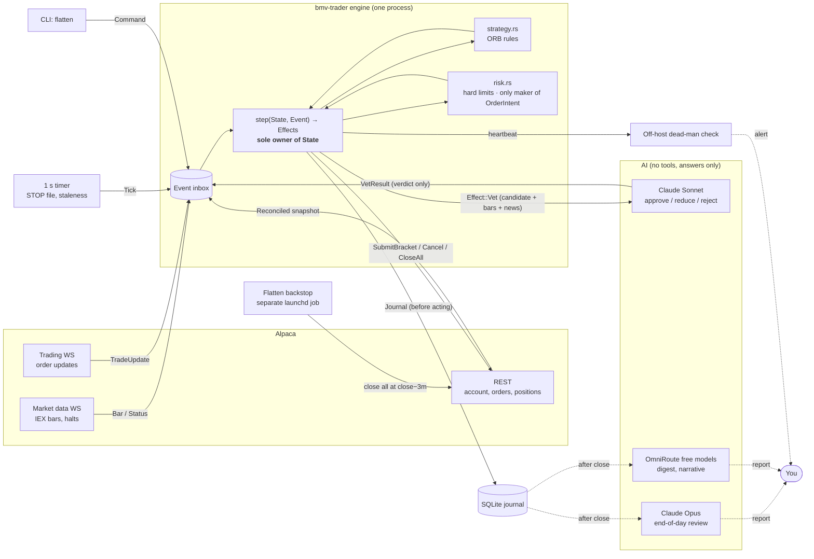
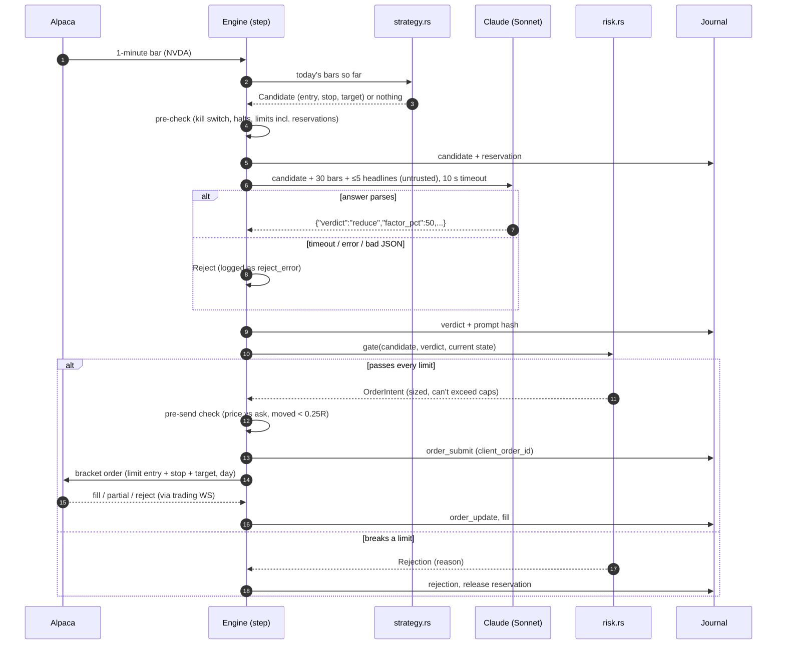

# bmv-trader — System Design

Status: draft v3 · 2026-11-02 · Current phase: **P1 (gate pending), P2 in progress**
See also: [DECISION.md](DECISION.md) (key decisions and why) · [FLOW.md](FLOW.md) (how the flow runs, who decides).
v3 incorporates 4 independent reviews (architecture, silent failures, type design, trading/broker fact-check). Alpaca facts are checked against docs.alpaca.markets as of 2026-11-02; anything marked **[verify]** must be tested in paper during P2 before code relies on it.

## 1. Goal

An AI-assisted intraday trading system for US stocks/ETFs (crypto later), running on a Mac during market hours.
Deterministic rules find setups, Claude vets them, hard-coded risk limits have the final say. Paper trading by default.
**The real goal is to find and prove an edge cheaply.** Every phase is gated, and failing a gate means stopping or going back.

**Non-goals (v1):** options, futures, overnight holds in the intraday book (the swing book, §7d, holds 2–10 days by design), 24/7 crypto, high-frequency trading, any UI that can place orders, cloud deployment.

**Monitoring:**
- Alpaca's dashboard for positions, orders and P&L (from day one)
- the terminal log plus `status` and `report` commands (P3)
- `watch` (terminal) and the `ui` web console on 127.0.0.1 (P3, DECISION S16): session state, account, equity against SPY, trial 10 progress, positions, orders, journal and trials, with STOP and flatten as the only safety controls; the Services page adds Start, Run and Restart buttons for Ollama, OmniRoute and the `desk`, `notes` and `llm` launchd jobs, each confirmed by a typed word (DECISION S24, S28)
- in P4 the console adds candidates, Claude's verdicts and Claude vs shadow; Tailscale access would be a new decision
- phone alerts (P5)

No UI ever has buy or sell buttons. The only controls are STOP and flatten.

## 2. Decisions

| Topic | Decision |
|---|---|
| Broker / data | Alpaca. Basic (free) plan: IEX real-time, websocket ≤ 30 symbols, 200 historical calls/min. IEX minute history starts late July 2020 (measured: none on 2020-07-15, present on 2020-07-27), so research uses 2020-08-03 on |
| Language | Rust, single binary |
| AI role | Rules generate candidates → Claude approves, reduces, or rejects → risk gate decides |
| Execution | Automatic in paper. In live, each order needs your confirmation (phone), plus a confirmation at the start of each live session. |
| Hours | Regular hours only. Every phase time comes from Alpaca's calendar/clock (half-days handled); flat 5 minutes before close. |
| Risk (paper) | $25k notional · ≤$2,500 per position · ≤1% ($250) risk per trade · daily halt at −2% ($500) · ≤5 positions · total open risk ≤ remaining daily budget |
| Money | Integer cents (`i64` newtypes); whole shares only |
| Free models (OmniRoute) | Never in the decision path. Summaries only, added after the P4 gate. |
| Claude (direct API) | Trade vetting. No fallback: any failure rejects the trade. |

## 3. Core principles

> **LLMs propose, code disposes.** **The broker is the source of truth.** **Unknown means stop.**

- **Claude can only shrink a trade.** It approves, rejects, or reduces by a percentage from 1 to 99. Its answer type has no field for symbol, side, stop or quantity, so the type system rules out the rest.
- Every model output is parsed strictly: unknown fields are rejected and nothing gets a default value. If it doesn't parse, it's a reject.
- News text is untrusted. It's delimited, length-capped, and logged raw next to each decision.
- Risk limits are plain Rust with unit tests. The only way to build an `OrderIntent` is `risk::gate()`, and the only way to place an order is `broker.submit_bracket(OrderIntent)`.
- **Positions, orders, fills and today's P&L always come from Alpaca.** The journal is an audit log and is never used to rebuild trading state.
- Any state the system can't confirm — stale data, a failed journal write, an unknown position, an order whose outcome is unknown, a kill-switch read error — means **no new entries** until it's resolved.

## 4. Architecture

```
            ┌────────────────────────────── bmv-trader engine (one process, tokio) ──────────────────────────────┐
 Alpaca     │                                                                                                   │
 market WS ─┼─► Bar / Status(halt, LULD) ──┐                                                                    │
 trading WS ┼─► TradeUpdate ───────────────┤                                                                    │
 REST snap ─┼─► Reconciled ────────────────┼──► inbox (mpsc) ──► ENGINE TASK: step(&mut State, Event) -> Effects │
 1 s timer ─┼─► Tick (STOP, staleness) ────┤                         │ sole owner of State                      │
 CLI ───────┼─► Command (flatten) ─────────┤                         ▼                                          │
            │  VetResult ◄── Claude task ◄─┴──── Effect::Vet / SubmitBracket / Cancel / Journal / Alert          │
            │                                    (spawned; result comes back as an Event)                       │
            └───────────────────────────────────────────────────────────────────────────────────────────────────┘
 Separate processes:  flatten-backstop (launchd timer at close−3 min) · watchdog (off-host dead-man check)
 Research:  history + backtest drive the SAME step() with a replay feeder and a simulated broker
```

### Diagrams (render on GitHub / VS Code with Mermaid)

**Architecture.** Arrows into the engine are events; arrows out are effects. The AI only answers when the engine asks.



**One candidate.** Every arrow from the AI goes back through the engine and the risk gate. Nothing reaches Alpaca without them.



### Concurrency and state model
- **One engine task owns `State`** (open positions and working orders mirrored from Alpaca, reservations, counters, halts). No shared mutexes.
- Everything that happens arrives as an `Event` on one inbox. Everything the engine wants done goes out as an `Effect`. Network effects run in spawned tasks, and their results come back as events.
- **The core is pure: `step(&mut State, Event) -> Vec<Effect>`.** The backtest and the live engine run this exact function, so the two paths can't drift apart.
- **Reservations:** from the moment a candidate is sent to Claude until its order fills or is cancelled, it counts against every limit (positions, notional, open risk, clusters, trades/day). The risk gate runs again on the current state when the verdict comes back, and again after a live approval.
- **Journal before act:** an effect is written to the journal before it is executed. If the write fails, the engine halts entries.
- **On startup and after any reconnect:** take a REST snapshot of positions, open orders and today's fills, then emit `Reconciled`, which replaces all broker-owned state.

## 4b. Three-layer extension (planned 2026-11-03, owner approved)

Three local services sit **above** the Rust engine. They can only propose; the engine alone can trade.

```
 Agents layer   paperclip (Node + Postgres, 127.0.0.1:3100)  schedules, human approvals, budgets, audit
      │  wakes on a schedule (minutes, never in the order path)
 Analyst layer  TradingAgents (Python sidecar)               a rating + thesis per ticker, as strict JSON
      │  reads
 Data layer     OpenBB API (127.0.0.1:6900) + Alpaca         earnings, FRED, SEC, ETF holdings | prices
      │  proposals only: data/proposals/*.json
 Rust engine    risk gate · broker · STOP · flatten · journal   the only process with Alpaca keys
```

| Layer | Source (`REFERENCE-REPOS/`, gitignored) | What we use | What we don't |
|---|---|---|---|
| Data | OpenBB v5 (Apache-2.0) | Earnings calendar and surprises (nasdaq), FRED macro, SEC fundamentals, ETF holdings, split/dividend calendars | Prices. v5 dropped the price vendors, and it has no delisted or point-in-time universe, so Alpaca stays the price source |
| Analyst | TradingAgents (Apache-2.0) | The 5-level rating (Buy … Sell) and its thesis | Its entry, stop and size (LLM-invented); its final authority |
| Agents | paperclip (MIT) | Cron routines, board approvals, per-agent budgets, the audit trail | Any order path or real-time decision; latency is ≥ 30 s |

**Trust boundaries (each enforced in code or config, and tested):**
1. **No sidecar sees broker keys.** Alpaca keys stay in the Keychain and are read only by the Rust binary. The sidecars run with a scrubbed environment.
2. **One direction.** Sidecars write proposals to `data/proposals/`. The engine parses them strictly (unknown fields rejected) into the existing verdict type: approve, reduce or reject, so they can only shrink a rules candidate. A rating can never become an order by itself.
3. **Claude only.** TradingAgents' deep and quick tiers are pinned to `anthropic` with the §10 model ids. Its social-post pre-screen (`TYPESAFE_API_KEY`) is off. paperclip agents use `claude_local` or a process adapter calling the Anthropic API. Free models stay out of the decision path (§2).
4. **Untrusted text.** The social analyst (Reddit, StockTwits) is off until its text is delimited and capped like §3's news. News reaches prompts only inside `<untrusted_news>`.
5. **Local only.**
   - OpenBB binds to 127.0.0.1 with Basic auth on, because CORS defaults to `*`.
   - paperclip runs in `local_trusted` mode on loopback with telemetry off (`PAPERCLIP_TELEMETRY_DISABLED=1`).
   - Neither is exposed off the Mac.
6. **Unknown means stop.** If a sidecar is down, slow or returns something unparseable, that is a reject, never a default approve.

**Measuring the analyst:**
- TradingAgents can't be backtested honestly, because the model already knows how past prices turned out (§13).
- It is judged by a pre-registered **forward paper test**: daily ratings for a fixed list, scored over fixed horizons against SPY and a random baseline, logged in `trials.jsonl`.
- A failed test means it gets no authority.
- Acting on multi-day ratings needs overnight holds, which is a non-goal (§1) until that test passes.

**Build order:**
1. Data: an OpenBB sidecar plus a Rust client, first used for a deterministic "no new entry within 2 sessions of earnings" pre-check.
2. Analyst: a TradingAgents sidecar, run Claude-only with JSON output and per-ticker cost measured first, then the forward test.
3. Agents: paperclip routines for the pre-market run, end-of-day review and research proposals, with board approval for any strategy change.

**Desk roles** (after the owner's reference "Grok Bot trading team" post). Its process is kept: one job per role, every idea through every step, a journal, paper first, and approval for live orders. Its authority model is replaced, so that rules live in code and no LLM holds broker keys:

| Post role | bmv-trader | LLM or code | Authority |
|---|---|---|---|
| You | Console, briefs, live-order approval (P5) | — | Approves live orders and strategy changes; only you clear STOP |
| Chief of Staff | paperclip agent | LLM (routing per §10) | Routes work. Writes the 07:30 brief, 16:30 close report and Sunday review. Can't trade or change rules |
| Scout | Rust `scout` scan (movers, volume, earnings, Alpaca news), then a Claude "why", with a source and time | Code finds, LLM explains | Proposals only. "No signal" is a valid answer |
| Chart Analyst | Rust indicators on daily bars: the Desk Signal (§7d), giving a 1–10 score | Code | A score of 7 or more passes |
| Strategist | Backtester and P1 gate. An LLM may suggest a variant; code tests it once, as a logged trial | Code decides | Only a gate-passing strategy trades |
| Analyst desk | TradingAgents debate, giving a rating mapped to approve, reduce or reject | LLM (Claude direct) | Can only shrink or veto a code candidate |
| Risk Officer | `risk::gate` plus the event filter (earnings, FOMC, CPI inside the hold), with swing limits (§9). An LLM reviewer gives advisory notes only | Code is final | Veto in code, naming the rule |
| Trader | Rust swing executor: limit entry, GTC stop, no chasing (§8 step 5) | Code | Executes gated intents only |
| Journal | `data/journal.jsonl` plus `data/desk.jsonl` (handoffs and proposals) | Code | Audit trail |
| Kill switch | STOP, flatten, backstop (closes everything but the owner's drill positions in `data/drill.json`; scoped to the intraday book once a swing book exists), plus Alpaca account settings | Code and broker | "A prompt is a request; a broker setting is a wall" |

- **Desk Rules for agents** are a read-only file, `data/desk_rules.md`, generated from the Rust `Limits`. Prompts can't drift from the code.
- **Sidecars install from pinned public releases** (PyPI, npm or a git commit), never from `REFERENCE-REPOS/`, which is reading material only and may be deleted.

## 4c. Quant Desk: Paperclip agents in segregated roles (owner's spec, decided 2026-11-04)

The owner's "Autonomous Quant Trading Desk" spec is the target. Agents do knowledge work; deterministic Rust does every number and every order. **The Rust Desk API is the only authority** (S30). Paperclip schedules agents (org chart, tickets, heartbeats, budgets), but it can't open a gate. Built in the spec's order (§12 of the spec), stopping after each step for the owner. The existing engine, risk gate and order path are kept and wrapped, not rewritten.

### Roles

| Agent | Line | Model (S31, S32) | Desk API tools (everything else refused) | Never |
|---|---|---|---|---|
| Head of Desk | Orchestration | local, Claude for the daily summary | tickets, status, reports | sign, approve, change limits |
| Quant Researcher | Front office | OmniRoute research route (free or local) | read market data (research period only), create Hypothesis, run exploratory stats | write code, official backtests, sign, see the account |
| Quant Strategist | Front office | free or local for drafts, Claude for the final consistency pass | create and edit StrategySpec in DRAFT, request research | implement, run official backtests, change criteria after the first backtest |
| Quant Developer | Front office | Claude Code (coder) | submit StrategyVersion (code in `strategies/`), dev backtests in-sample | touch `execution/`, `risk/`, `validation/` or `stress/`; read held-out data; mark own work validated |
| Trading Platform Engineer | Technology | Claude Code (coder) | submit changes to `execution/` and data plumbing | strategy logic, limits, approvals |
| Independent Model Validator | Second line, reports to the Board | **a non-Anthropic family**, chosen before step 3 (S31) | read artifacts (spec, code, results), run the official backtest, read held-out data, file ValidationReport | edit code or specs, see authors' conversations |
| Stress Testing Lead | Second line | Claude, direct | run the stress battery, read held-out data, file StressReport | modify strategy or limits |
| Market & Trading Risk Manager | Second line | local for routine checks, Claude for incidents | propose limits, tighten limits, halt | loosen any limit, approve own proposal, place orders |
| Compliance Officer | Second line | Claude, direct | file ComplianceReview, block, halt | approve live alone |
| Trading Ops / SRE | Operations | local for routine checks, Claude for write-ups | read positions and orders (read-only), reconcile, halt, cancel, restart services | resume after a risk halt, change strategy or limits |
| Strategy Product Owner | Assistant to the Board | Claude, direct | file StrategyReview, trigger re-validation, halt on decay thresholds | approve changes to a live strategy |
| **Board (the owner, human)** | — | — | sign LIVE_APPROVED, raise or loosen a limit, resume after a risk halt, change the org | — |

### Rules enforced in code
- **Identity:** each agent has its own Desk API token, mapped to one role. Every endpoint checks, in order: permission, state legality, maker-checker (approver role ≠ author role and approver agent ≠ author agent), budget, and only then writes an audit row.
- **Free or local models may author, never sign** (A5 kept). Every signer uses a pinned strong model, called directly with the model name checked in every reply (A4 kept for the second line). The research routes go through OmniRoute.
- **The human signature:**
  - LIVE_APPROVED, loosening or raising a limit, and resuming after a risk halt need a Keychain item that asks for **Touch ID or the owner's password**. No agent can satisfy that prompt.
  - Agents have no shell: only Desk API tools over MCP. The exception is the coding agents below.
- **Coding agents (Developer, Platform Engineer):**
  - Each works in its own git worktree, under a macOS sandbox with no Keychain, no held-out data, and no broker keys.
  - A scope check rejects any change outside the role's folders.
  - **A merge needs the scope check, then a Validator PASS, then the owner's approval** (S29).
- **Held-out data (S33):**
  - The untouched year is spent by trial 12.
  - New strategies get a **screen** on 2023–2025, kept from front-office agents. The screen can only reject.
  - The **verdict** is on data that arrives after the spec freeze (forward or paper, 3–6 months).
  - The Desk API serves held-out rows only to the Validator and Stress Lead.
- **Variants:** every variant counts toward its hypothesis's significance bar. The Validator applies the deflated Sharpe ratio, and FAILs a strategy that passes only because many variants were tried.
- **Rerun (R12):**
  - **First,** the Validator reproduces all 11 logged trials exactly, as the desk's acceptance test.
  - **Then** agents may propose new variants on 2016–2025. Each is pre-registered and counted as a new trial, and none can pass on old data alone: the forward verdict decides.
- **No agent can reach Alpaca** (S20). Orders come only from the Rust engine, through the risk gate, for a strategy in a LIVE state.

### Lifecycle (who signs each step)
IDEA → HYPOTHESIS_APPROVED (Strategist) → SPEC_FROZEN (Product Owner; criteria and held-out period locked) → IMPLEMENTED (Strategist reviews the Developer's code against the spec) → VALIDATED (Validator) → STRESS_TESTED (Stress Lead) → LIMITS_SET (Risk proposes, **Board** approves) → COMPLIANCE_CLEARED (Compliance) → PAPER_TRADING (automatic; at least 20 trading days **and** 30 trades) → PAPER_REVIEWED (Product Owner and Risk; paper results within tolerance of the backtest) → LIVE_APPROVED (**Board**, Touch ID, with the approval pack) → LIVE (25% of limits for 10 days) → LIVE_FULL_SIZE (**Board**).
- Anyone can move anything to HALTED.
- Leaving HALTED after a risk or compliance halt is **Board** only.
- RETIRED is **Board** only.
- A FAIL returns the strategy to SPEC or IMPLEMENTED, and the version increments.
- A material change creates a new StrategyVersion, which restarts at IMPLEMENTED.

### Data (SQLite through sqlx, schema ready for Postgres)
- **Tables:**
  - agents, roles, permissions, raci
  - strategies, strategy_versions (content hash), hypotheses, specs, artifacts
  - backtest_runs (hashes of inputs and results), validation_reports, stress_reports
  - risk_limits (versioned, with approver), compliance_reviews, approvals, state_transitions
  - tickets, incidents, halts, budgets, llm_calls
  - orders, fills, positions, reconciliations
  - audit_log
- **audit_log** is append-only. Each row stores the SHA-256 of the previous one, a daily job verifies the chain, and no role can update or delete rows.
- **The existing JSONL files** (journal, trials, lessons) are imported into the database, and stay readable.

### Paperclip containment (S34)
- **Version:** an exact version, never `@latest`, with a monthly check for security updates.
- **Network:** its own folder; dashboard and API on 127.0.0.1 only.
- **Telemetry:** off. Traces are never shared, and its network connections are checked on first run.
- **Keys:** a **separate Anthropic key and workspace with a hard monthly limit**, set in Anthropic's console and kept apart from trial 10's key. The owner creates it; it lives in the Keychain.
- **Budget:** **$100 a month in total** across all paid models. Risk and Ops do routine checks on the local model. The second line gets budget priority: research pauses first.
- **Rollout in waves:**
  - **Wave 1:** Head of Desk, Researcher, Validator, Stress Lead.
  - **Wave 2:** Strategist, Developer, once a hypothesis passes the screen.
  - **Wave 3:** Risk, Compliance, Ops, Product Owner, Platform Engineer, once a strategy heads to paper.
- **Compliance:** supports margin under $25k (the PDT limit of 3 day trades in 5 days), margin of $25k or more, and cash accounts (settled cash only). It tracks wash sales. The owner picks the account before any live approval.

### Step 1 as built (`crates/desk`), and what step 2 must close
- **Layout:** `store`, `audit`, `lifecycle` and `permissions` are modules of one `desk` crate, not four crates. They can be split later.
- **Enforced and tested:**
  - **Permissions:** agents can't hire; an agent's role comes from the store; the Developer can't read held-out data.
  - **Gate rules:** maker-checker by agent and by role, every forward gate checking its evidence from the store, no skipping, and halting only through `halt`, which records its reason.
  - **Who may halt and resume:** only the Risk Manager or Compliance may call their own kind of halt, and only the owner lifts it.
  - **Frozen artifacts:** criteria freeze at the spec, or at the first backtest. Code changes only before validation; after that, the strategy must fail back to a new version.
  - **Limits and budgets:** limits come from an allowlist, are never negative, and only the owner sets or loosens them. Budget check and charge are one atomic step.
  - **History:** append-only tables, `INSERT OR REPLACE` included; a hash chain with every signer on each step; an empty log counts as tampering.
- **Gaps that build step 2 must close:**
  - **Anchor the head hash** outside the database, or key it with a Keychain secret. Today someone who can write the file could rewrite the whole chain.
  - **Run the desk as its own macOS user,** with the database at mode 600.
  - **Bind each `HumanProof`** to one action, strategy and target state, with a nonce, an expiry, and its id in the audit entry. Today each proof is single-use but not bound to an action.
  - **The real Touch ID prompt:** until it exists, no code outside tests can prove a human, so every human-only action is refused.
  - **Use `BEGIN IMMEDIATE`,** or one writer process, once more than one process opens the database.
  - **The spec's §11 items "halt cancels orders within 5 s" and "a Validator mismatch is an automatic FAIL"** arrive with steps 6 and 3.

### Step 2 as built: owner approvals, Desk API, MCP tools, the desk user
- **Owner approvals (`owner.rs`, `swift/desk-sign.swift`):**
  - Each human-only action waits as a request, with a nonce and a 10-minute expiry. At most 5 can wait per agent.
  - It runs only after the owner's Secure Enclave key signs that request's exact text, which needs Touch ID or the password.
  - The desk keeps only the public key. Each approval is redeemed once, and a request reopens if its action fails.
  - `desk sign` rebuilds the text from the action it shows before Touch ID.
- **Desk API (`api.rs`):**
  - axum on 127.0.0.1:8790 only, and Host must be loopback.
  - One bearer token per agent, stored as SHA-256. Reissuing a token revokes the old one.
  - The role comes from the store. Bodies are 64 KB at most, and unknown fields are refused.
  - There's no HTTP way to become the owner: `desk init` registers in-process, as the database's user.
  - A lifecycle step collects signatures for one version in one transaction. A signature from a role the step doesn't need is refused and never kept.
- **MCP tools (`mcp.rs`, `desk-mcp`):**
  - A stdio bridge that Paperclip starts per agent with that agent's `DESK_TOKEN`. Each tool is one API call.
  - Owner-only routes (approve, audit) have no tool. A refusal returns to the agent as an `isError` result.
- **The desk user (`scripts/desk-setup.sh`, run by the owner with sudo):**
  - A hidden `bmvdesk` user, with no shell and no login.
  - Root-owned binaries in `/usr/local/libexec/bmv-desk`.
  - The database in `/usr/local/var/bmv-desk`: directory mode 700, file mode 600, and umask 077.
  - The LaunchDaemon `com.bmv.desk`.
- **Still open:**
  - **The audit head isn't anchored outside the database.** Only `bmvdesk` and root can now write it, but either could rewrite the whole chain.
  - **`BEGIN IMMEDIATE`** is needed if a second long-lived writer appears. Today only `desk init` writes alongside the server, and only once.
  - **Secure Enclave key rotation** isn't designed yet.

### Step 5 plan: Paperclip wave 1 (S36, owner 2026-11-05)
- **Runner:** Paperclip's `process` adapter starts our `desk-agent` on each heartbeat. It calls the model directly with only the role's desk tools (no shell, files or web), rejects a reply from any other model, charges the desk budget, and reports cost and a short note to Paperclip from code. Paperclip's own curl skill and Claude Code adapters are not used.
- **Isolation:** Paperclip and the runner run as a hidden macOS user, `bmvclip`, in `authenticated` mode on 127.0.0.1 only. Paperclip is pinned at 2026.1023.0 with its lockfile; telemetry, announcements and update checks are off.
- **Models and budget (per month):** Validator and Stress Lead on Sonnet 5.5 ($35, $25); Head of Desk on the local model with Haiku 5.5 for its daily summary ($5); Researcher on OmniRoute's free route ($0); $35 held for waves 2-3.
- **Schedule:** the Validator and Stress Lead wake only when a strategy reaches their gate; Head of Desk daily at 16:30 ET; Researcher daily. Switched on after trial 12 ends.
- **Part 1 as built: the server's limits.** At most 32 connections at once (the rest wait in the backlog). A request gets 5 s, then a 503 and its transaction rolls back. A connection that moves no bytes for 10 s is closed, and none lives past 15 s. Still open: a local process that keeps reconnecting can fill all 32 slots; the fix would be a reserved path (a Unix socket) for the owner and the engine.

- **Part 2 as built: the runner (`desk::agent`, `desk-agent`).**
  - `desk-agent CHARTER SECRETS` runs one heartbeat. The charter (role prompt, task, provider, pinned model, tools, max tokens and turns) must not be writable by the agent's user; the secrets file (desk token, and the Anthropic or OmniRoute key) must be readable by it only.
  - The model is offered only the charter's tools, through the same code `desk-mcp` uses; any other tool it names is refused before the desk. A free model is never offered `sign`. Tool results are capped at 20,000 characters.
  - Before each paid call the runner checks the desk budget covers the worst case (the whole request as input, every allowed output token). After it, the actual cost is charged to the desk (`POST /v1/budget/charge`, at most $10, the caller's own budget only), before anything else is read from the reply. A reply with no usage is booked at the worst case.
  - A reply from another model, an early stop (`max_tokens`, a refusal), a malformed reply, or running out of turns fails the run (exit 1), so Paperclip shows it as failed.
  - Each call's usage goes to Paperclip's cost events, only on a plain-HTTP loopback URL. The client follows no redirects and uses no proxy.
  - **Still open:** the desk can't tell which model made a `sign` call, so A5 rests on the runner and the charter (a signer's token must only ever be in a signer's secrets). A call that fails after it was sent isn't charged. Two runs of one agent at once could overspend by one call each; Paperclip runs one at a time per agent.
- **Part 3 as built: the `bmvclip` user and Paperclip (S37).**
  - `scripts/clip-build.sh` (as the owner) fetches Node 24.16.0 from nodejs.org, checked against a pinned SHA-256, and installs Paperclip 2026.1023.0 exactly as `deploy/paperclip/package-lock.json` pins it, with every install script off. It prints one hash of the whole tree.
  - `sudo scripts/clip-setup.sh` copies the build into a root-only staging folder, shows the same hash, and installs it root-owned in `/usr/local/libexec/bmv-clip`. Any symlink leading out of the tree, and any setuid or setgid file, is refused (`scripts/tree-hash.py`). The new tree is swapped in whole, so an interrupted run leaves the old install or the new one.
  - **Database:** Paperclip's built-in one has the fixed password `paperclip`. So `bmvclip` runs the same Postgres itself on 127.0.0.1:54330, with no Unix socket and a random password in a file only it can read.
  - **Paperclip:** `authenticated` and private, on 127.0.0.1:3100. Telemetry, announcements and update checks are off, and secrets strict mode is on. It runs only through `/usr/local/libexec/bmv-clip/clip`, which fixes its environment.
  - **Files:** charters in `/usr/local/etc/bmv-clip` (root's) and keys files in `/usr/local/var/bmv-clip/keys` (`bmvclip`'s alone). Root makes only the top data folder; everything inside it is made as `bmvclip`, so a link `bmvclip` plants there can't steer a root write on a rerun. Logs are `bmvclip`'s files in the root-owned `/usr/local/var/log/bmv-clip`. `desk-setup.sh` now installs `desk-agent` too.
  - **Network check:** after the first start, the script stops Paperclip if anything `bmvclip` runs has a socket off loopback.
  - **Still open:**
    - **All agents share one user,** so any agent's process can read every keys file. A compromised Paperclip could hand the Validator's desk token to a run that uses a free model. The OS doesn't separate agents; the charters and the runner do. Fix: a separate user for each signer, decided in part 4.
    - **The network check is a snapshot** 30 s after start. Once agents call Anthropic, only a per-user firewall rule (loopback and `api.anthropic.com`) would limit where keys could go.
    - **Sign-up stays open** until the owner's login exists (Paperclip refuses the first account otherwise); `sudo scripts/clip-close-signup.sh` then closes it.
    - **The tree hash protects against a changed build folder, not changed scripts.** Root runs `clip-setup.sh` from the repo, which the owner's user can edit. `desk-setup.sh` has the same pattern, and still logs into `bmvdesk`'s own folder.
    - **Upgrades:** a Paperclip version that moves Postgres to a new major version needs a dump and restore.
- **Part 4 as built: the agents file and the four agents (S38).**
  - **`deploy/agents.json` is the one place** that sets each agent's role, user, provider (`anthropic`, or `omniroute` for local and Gemini routes), model, budget, schedule, prompt, task and desk tools. `desk-agent AGENTS AGENT SECRETS` reads it on every run; `desk-agent --list` gives the setup scripts the same facts.
  - **Checked on every read:** only wave-1 roles. **A signer is decided by role** (Validator, Stress Lead), not by its tool list, because the desk lets any second-line token sign over plain HTTP. A signer must run on Claude, as its own user shared with no other agent. Every user is a `bmv` one, never an existing system account. Every Claude model has a price, budgets are decimals of at least 0, schedules are 5-field cron lines, and unknown fields are refused. `desk-agent` also refuses a keys file that is a link or not a regular file.
  - **`sudo scripts/clip-agents-setup.sh`** shows the file's agents and the change from the installed copy, installs it root-owned in `/usr/local/etc/bmv-clip`, makes each signer's user and keys folder (`/usr/local/var/<user>`), and writes `/etc/sudoers.d/bmv-clip` after `visudo` checks it. The rule lets `bmvclip` run exactly `desk-agent <agents file> <agent> <its keys>` as each signer, keeping only Paperclip's run variables. **A model change is an edit to the file and a rerun of this script.**
  - **`scripts/desk-wave1.sh agents | tokens | budgets`** files the desk requests from the installed file; the owner approves each with `desk sign` (Touch ID). Budgets are per calendar month, so `budgets` is rerun each month.
  - **`scripts/clip-keys.sh <agent>`** writes one keys file as the agent's own user, mode 600: the desk token from a hidden prompt, the model key from the Keychain (`bmv-desk-models` / `anthropic-desk` or `omniroute-agents`). No key is put on a command line.
  - **`scripts/clip-agents-sync.py`** makes Paperclip match the file through its own CLI: the company `bmv Quant Desk`, one `process` agent per desk agent (10-minute limit, one run at a time, timer heartbeats off, Paperclip budget equal to the desk's), and a routine for each scheduled agent, created paused.
  - **Paperclip's budgets allow unpriced usage.** Paperclip records an unpriced cost event for every process-adapter run, and its default policy treats any unpriced event as a hard stop, which paused the company after the first test run. The sync sets `unpricedUsagePolicy: allow` on every policy. The desk stays the budget authority, and the runner's priced reports still count toward Paperclip's limits.
- **S39: all four agents on Claude, models in their own file.**
  - **`deploy/models.json`** holds each agent's provider, model and monthly budget, and nothing else. `deploy/agents.json` holds the rest. `Agents::parse` reads the pair: every agent must be in both, a model line in the agents file is refused, and then every rule above applies to the combined entry. `desk-agent` reads `models.json` from beside the agents file, with the same ownership checks, and `clip-agents-setup.sh` checks and installs both.
  - **Models and ceilings (S40):** Head of Desk on Haiku 5.5 ($1 a month), Researcher on Sonnet 5.5 ($3), Validator and Stress Lead on Sonnet 5.5 ($5 each). The Head of Desk and Researcher run as `bmvhod` and `bmvres`. Any agent on Claude must run as its own user, so no Anthropic key ever sits in `bmvclip`'s files.
  - **To change a model:** edit its line in `deploy/models.json`, then run `sudo scripts/clip-agents-setup.sh`. Moving an agent to a new user also needs a new token and keys file, and a rerun of the Paperclip sync.
- **S41: one central models file, and monthly key rotation.**
  - **`deploy/models.json`** has an `agents` section (read by `desk-agent`) and an `engine` section (read by `bmv_trader::llm`). Every line has a `claude` true/false switch, a `claude_model`, an optional `free_model` (the OmniRoute route) and a monthly `budget_usd`.
    - **Locked to Claude:** the signers (by role, A5) and `notes` (account data).
    - **Always ready:** a line's Claude model must have a price even while it's switched to free, so flipping to Claude always works.
    - **Applying a change:** engine switches apply on the next run. Agent switches apply after `sudo scripts/clip-agents-setup.sh`.
  - **Each agent's keys file holds both keys** (Claude and OmniRoute), so a switch needs no new keys.
  - **`scripts/rotate-keys.sh`** (monthly, guided, each step skippable; replaced by the S43 key tracker):
    1. it renews the desk budgets
    2. it rotates the engine's Claude key
    3. it rotates the desk agents' Claude key (into every keys file via `scripts/clip-key-swap.sh`, keeping each desk token)
    4. optionally, it rotates the agents' OmniRoute key
    - **It proves each key** before it replaces the old one: a new key goes to a temporary Keychain item, is tested with a free call to the models list, and only then becomes the real one. A failed agent list stops the script, and a step that stopped halfway can be resumed. Each key's date goes in `data/keys_rotated.json`, and the health check uses the older one.
    - **Old keys** are disabled by hand in the Console: Anthropic keys can't be created by API, and the script holds no Admin key.
  - **Reminders:** the health check warns after 35 days, and `deploy/com.bmv-trader.monthly.plist` posts a notification on the 1st.
- **S42: the free cloud models' keys.**
  - **`bmv-trader free-keys`** (launchd `com.bmv-trader.freekeys`, every 6 hours) rotates the OpenRouter key when it is due (`free_keys.rotate_every_hours` in `deploy/models.json`):
    1. It creates `bmv-free-<date>` through OpenRouter's key API, with the management key from the Keychain (`bmv-trader` / `OPENROUTER_MANAGEMENT_KEY`). The new key has a credit cap of $0.01 (OpenRouter refuses $0), so it can spend at most a cent and an expiry a week past its rotation date.
    2. It hands the key to OmniRoute (`providers rotate --from-env`, in one child's environment), and OmniRoute tests it.
    3. Only after the test passes is the old key deleted. On any failure the new key is deleted and the old one stays.
    - **Every pass also deletes** any key it made that isn't in use, and a disabled one in use. Keys others made are never touched.
  - **Providers with no key API** (Groq, Google AI Studio) are added or replaced with `scripts/free-key-add.sh <provider>` (hidden prompt; stdin or a child's environment, never argv), and logged with their `expires_days`.
  - **Records:** key values live only in OmniRoute's encrypted store. `data/free_keys.jsonl` is an append-only event log of metadata (provider, connection, key id, created, active, retired, failed, expiry); a key's state is its latest event.
  - **Health:** the daily check shows each provider's key: days left, expired, or a failed rotation.
  - **Load balancing** is OmniRoute's `bmv-free` combo, across providers.
  - **Not built:** keys or accounts made to get more free capacity. OpenRouter says extra keys don't change its limits, and free tiers forbid getting around their quotas.
  - **Safety on failure:**
    - One pass runs at a time (`data/free_keys.lock`).
    - Cleanup deletes only keys this job's own log says it created, never one still pending: created, with the handover's outcome unrecorded. A pending key forces the next pass to rotate again, which repairs it.
    - Every failure is logged as Failed, and the health check shows it, as well as a rotation that is overdue.
    - After a refused handover, the connection is tested again, so a dead key in OmniRoute can't go unnoticed.
    - OmniRoute's own output never goes into the log, in case it echoes part of a key.
  - **Still open:** OpenRouter refuses a $0 credit limit, so keys are capped at $0.01. If the account ever holds credit (for example for the 1,000-a-day free tier), that cent is the most a leaked key could spend. OmniRoute's own usage and quota numbers aren't in the health check yet.
- **S43: every key in one place.** `bmv-trader keys` (`scripts/keys.sh`, logic in `src/keys.rs`) lists every key the system holds: what it's for, where it lives, when it was renewed, when it's due, and its state.
  - **Dates:** keys renewed by hand are dated in `data/keys.json`. Automatic ones report from their own logs. Desk tokens and Alpaca keys are listed as "no expiry".
  - **Intervals:** set in `deploy/models.json` (`keys`): Claude keys 30 days, the OpenRouter management key and the OmniRoute agents key 90 days, warning 10 days ahead.
  - **`--notify`** (launchd `com.bmv-trader.keys`, 09:00) posts a macOS notification when any key is due within the window, overdue, missing, of unknown age, or its automatic rotation failed. The text is names only.
  - **`--renew`:** for each due key, it explains what the key is and what breaks without it, and lists where to get a new one. It takes a hidden paste and tests it with a free call: Anthropic's models list, or OpenRouter's key list for the management key. Only then does it save the key to the Keychain (through `security -i` on stdin), copy it into the agents' files that should hold it (`clip-key-swap.sh`), record the date, and say how to retire the old key. A wrong paste changes nothing.
  - **The daily health check** shows the same states for the hand-renewed keys. It replaces `scripts/rotate-keys.sh` and `data/keys_rotated.json`, whose dates are read once as a fallback.
- **S46: the evidence tool (built).**
  - **The `engine` role** (`Role::Engine`) is the only one with `PostEvidence`. No agents file may give it (wave-1 roles only), and the owner adds it once, for `engine-1`.
  - **`POST /v1/strategies/{id}/evidence`** takes `{inputs_hash, body}`. The body is a JSON object with a `metrics` object of finite numbers, at most 48 KB. The desk:
    - computes the results hash (SHA-256 of the canonical JSON) and records the post as an official backtest (`record_backtest`)
    - stores the body in the append-only `evidence` table
    - does all of it in one transaction, so the run and its body land on the version the run was for, even when a non-reproducing post fails the strategy back to a new version
    - the engine is allowed only that automatic fail-back: it can't sign through `/sign`, forward or back
  - **`GET` (`strategy_evidence`)** returns the strategy's state, version and criteria, the latest evidence for the current version, and who has signed.
    - When the criteria read `{"checks": [{"metric", "min"|"max"}]}`, it also returns each criterion checked against the metrics. `checkable` says whether it could check them, and `all_criteria_pass` is false, never null, when it couldn't.
    - Only the fields the engine writes are returned (source, trial, name, period, units, verdict, checks, metrics), so no other text reaches a signer. Criteria are capped at 4,096 characters, and a stored body that can't be read is an error.
    - Readers are the Validator, Stress Lead, Head of Desk, owner and engine.
  - **`bmv-trader desk-evidence --strategy N --trial T`** turns a `data/stress.jsonl` result into evidence (`stress::desk_evidence`). Its metrics are expectancy, trades, Monte Carlo (5th percentile, share below zero, 95th-percentile drawdown), expectancy at double costs, share of positive years, deflated Sharpe and reproduction. The stress battery now records the deflated Sharpe as a number.
  - **Still open:** the engine's Keychain item is readable by anything running as the owner. It could be limited to the `bmv-trader` binary with a Keychain access-control list. The desk doesn't require a minimum set of criteria; the Product Owner's sign-off at the frozen spec is the control.
- **S45: the AI picks, the owner approves.** The build order to get there:
  1. **The evidence tool,** so the signers can read each strategy's criteria, reproduction hashes, stress results and deflated Sharpe. It comes with the date in each heartbeat.
  2. **Wave 2: the Strategist and Developer,** so ideas become strategies that code can test.
  3. **The recommendation:** the Head of Desk ranks the strategies that passed both signers and proposes one, with a capital amount inside the owner's caps.
  4. **The approval pack** (step 7, S47): shown and signed in `desk sign`: the recommendation, code-computed evidence and its hash, both sign-offs, dissent, risks and caps, approved or rejected with Touch ID.
  - **The owner's caps** (capital per strategy, daily loss, position size) are set once, loosened only with Touch ID, and enforced by the risk gate on every order.
- **Part 5, the signers' dry run (2026-11-05).** One heartbeat each, by hand, while trial 12 ran.
  - **Both succeeded:** Validator $0.0071 and Stress Lead $0.0070, 2 turns each. Each ran as its own user through its sudo rule, the desk accepted its token, the reply model matched the pin, and each call was charged to the desk and reported to Paperclip priced.
  - **Fail-closed checks seen on the way:** a missing keys file, and no desk budget that month. Both stopped the run before any paid call.
  - **Gap they found: the signers can't see the evidence.** No desk tool returns a strategy's pre-registered criteria, reproduction hashes, stress results or deflated Sharpe, so neither could ever sign properly. A read-only evidence tool for the second line comes before any real gate.
  - **Head of Desk and Researcher (S39/S40, on Claude):** both passed. The Researcher (Sonnet, $0.0086, 3 turns) registered the desk's first idea, post-earnings drift conditioned on analyst estimate dispersion. The Head of Desk (Haiku, $0.0006) wrote an accurate close report. A wrong token in a keys file failed safely at the desk's login check, before any spend.
  - **The dry run's total was $0.023 for all four agents.**
  - **Seen:** the agents aren't told today's date, so the close report says "date not supplied". Next change: the runner adds the date to each task.
  - **Accepted risk: free-model text reaches the signers.** The local Researcher writes strategy names and hypotheses that the Validator then reads through `list_strategies`. The defences are that tool results are capped at 20,000 characters, the prompts treat desk data as untrusted, and a gate also needs its evidence from the store (deterministic runs and hashes). But a signer could still be talked into signing something the evidence allows. Review before the first real gate.
  - **Still open:** desk budgets need renewing each month. The OmniRoute agents' key must also allow any Gemini route an agent is switched to. Nothing here has run against the live Paperclip yet; part 5's dry run is the first.

### Step 3 as built: run hashes and the stress battery
- **`bmv-trader stress-battery`** re-runs every finished trial twice through the same code as `trial-autopsy`.
  - Each run gets an inputs hash (trial, parameters, period, cost and a data fingerprint) and a results hash (every row's date, exact value and exit).
  - It then runs the owner's bars from `src/stress.rs`, fixed before the first run:
    - Monte Carlo
    - cost ×2 (×3 is reported)
    - parameters ±20%, for trials 1–6 only; the others have compiled constants and count as not tested
    - by year and by SPY regime
    - deflated Sharpe, against all registered trials.
  - A test that didn't run is never a pass. Output goes to `data/stress.jsonl`, and the table to `docs/REPORT-2026-11.md`.
- **The desk:**
  - `record_backtest` reports whether a run reproduces.
  - An official run with the same inputs as an earlier run of the version, but different results, fails the strategy back to SPEC_FROZEN and a new version. That's the spec's §11 automatic FAIL.
  - The VALIDATED gate refuses any version with a mismatched pair.
- **First run (2026-11-04):** all 10 finished trials reproduce, and all 10 fail. Momentum (trial 7) is the only one that survives costs and most years.

### Step 4 as built: allow-list, drawdown halt, desk link (paper)
- **Ticker allow-list:** `config/allowlist.txt` is edited by the owner and merged only by them.
  - The risk gate refuses any symbol not on it (`Rejection::NotAllowed`), and the startup self-test proves it fires.
  - A run refuses to start if its watchlist goes beyond the list, or if the list is missing, empty or malformed.
  - `risk::Allowed` defaults to allowing nothing. Only research backtests pass `Allowed::Any`.
- **Drawdown auto-halt (owner, 2026-11-04):** 10% below the equity high-water mark on paper, 5% live.
  - The peak lives in `data/equity_peak.json` and moves up at each session start.
  - A breach engages the kill switch with the reason, and nothing trades until the owner clears it.
  - Intraday losses stay capped by the daily-loss halt.
- **Desk link, `src/desk_link.rs`:** off until step 5 (owner, 2026-11-04).
  - With `BMV_DESK_LINK=on` and `BMV_DESK_STRATEGY=<id>`, a run signs in as an Ops agent, using the Keychain item `bmv-desk/<agent>`.
  - It trades only while the desk has that strategy in `paper_trading` (or live, on a live account).
  - Each desk limit only tightens the engine's own (`Limits::tightened`). A limit the engine can't enforce yet, such as `max_correlated_exposure_pct`, refuses the run.
  - A drawdown halt, or a run that stops on an error, is reported to the desk as an operational halt.
- **Still open:** anything that can delete `data/equity_peak.json` resets the peak. Agents can't, being sandboxed with no shell. Moving the peak into the desk database in step 6 would close this.

### Build order (the spec's §12; the owner's go-ahead after each step)
1. The `store`, `audit`, `lifecycle` and `permissions` crates, with the spec's §11 tests.
2. `desk_api` (axum) plus MCP tools.
3. Backtest and stress harness: deterministic run hashes, Monte Carlo, cost shocks, parameter sensitivity, regime split, deflated Sharpe. The Validator reproduces all 11 trials.
4. Risk and execution, paper only: wrap `risk::gate` and the engine; add a drawdown auto-halt and a ticker allow-list.
5. Paperclip company config, wave 1.
6. Ops: reconciliation every 15 minutes, a halt that cancels orders within 5 s (tested with a mock broker), and the daily report.
7. The approval pack in `desk sign` (after wave 2), and the console's read-only Desk page (built 2026-11-05): requests waiting for the owner, pipeline, halts, budgets, audit result and keys, read every 2 minutes with the `console-1` login, in Shadcn Admin's design patterns without its code or npm (S47).

The 30 November feedback report draws on whatever exists by then: trial 12, the stress battery, deflated Sharpe, the cost check.

### Options (S48, parked by R14 until a stock signal passes Level B; designed, built after step 6)
Buy-only long calls and puts on Alpaca paper. Alpaca takes contract orders on the same Orders API (whole contracts, `day` or `gtc`, no extended hours, no bracket orders), reports them in the same Positions API, and reports expiry, exercise and assignment as non-trade activities, which on paper appear the next day. The engine is built for a long stock bracket today, so each phase below has the owner's go-ahead.
1. **Types** (`src/contract.rs`): an `OccSymbol` parser (underlying, expiry, call or put, strike) with its own validator. The stock validators (`broker::valid_symbol`, `history::valid_symbol`, `Candidate::long`) stay stock-only. The ×100 multiplier lives in one function, `premium_usd(price, contracts)`, which every caller uses; a test pins it, since a missed multiplier under-sizes risk 100-fold.
2. **Risk** (`src/risk.rs`): a contract gate where risk is the full premium, never entry minus stop. Premium within `max_risk_per_trade`, open premium within a new `max_open_premium_usd` (which `Limits::tightened` accepts, so the desk can only lower it), and the shared position limit and daily loss halt. `cluster_of` keys on the underlying.
3. **Data:** contract lookup (`/v2/options/contracts`) filtered to 21 to 60 days from expiry, near the money, open interest and spread; option bars and quotes, cached like stock history.
4. **Backtest:** a contract fill model (buy at the ask, sell at the bid, from indicative data plus a spread estimate, and a per-contract fee) and a forced exit 7 days before expiry. The stress battery and `desk_evidence` work on R-multiples and are reused as they are.
5. **Orders and positions** (`src/broker.rs`, `src/live.rs`): buy-to-open and sell-to-close limit bodies, with exits managed by the engine on daily bars. Positions are parsed with their asset class and OCC symbol, and `reconcile` handles contracts. The daily flatten at the close stays stock-only. Non-trade activities are polled each morning, and any assignment halts trading.
6. **Desk:** an `asset_class` on strategies (`us_equity` or `us_option`); the approval text shows the contract, its expiry and the most it can lose.
7. **News label** (`src/news_label.rs`): Claude reads a day's headlines for one ticker as data and replies exactly `good`, `bad` or `none`; anything else counts as `none` and is logged. Labels are cached by ticker, date and headline hash, so a backtest reproduces. History comes from Alpaca's news API, whose depth is checked first; the labelling cost is estimated and approved by the owner before the backtest runs.
8. **Trial:** pre-registered like trials 7 and 12: the news-label rule with the contract filter, backtested from February 2024, then 20 or more paper days and 30 or more trades.

## 5. Components → files

| Module | Responsibility |
|---|---|
| `config.rs` ✅ | `.env` → `Config` (fields private, secret redacted in `Debug`, base URL derived from `Mode`); fails on a `.env` parse error; reports which source set `TRADING_MODE` |
| `money.rs` | `Usd(i64)` cents, `Price(i64)` cents > 0, `Qty(NonZeroU32)`; parse from Alpaca's string fields; exact integer arithmetic |
| `broker.rs` ✅ | Alpaca REST with timeouts (5 s connect, 10 s total); typed responses (`Account`, `Position`, `Order`); `submit_bracket(OrderIntent)`, `cancel`, `close_all` — **no generic POST** |
| `market_data.rs` | Websocket with `feed=iex`: bars, `updatedBars`, `statuses`, `lulds`; ping/pong deadline; per-symbol staleness; REST backfill |
| `history.rs` | Download historical 1-minute bars with an explicit `feed=` and the feed recorded; throttled below 200 calls/min; resumable |
| `strategy.rs` | Pure: bars → `Candidate::long(...)` (validates stop < entry < target, minimum R) |
| `vetting.rs` | Prompt build + strict parse → `Decision { verdict: Approve / Reduce(Factor) / Reject, rationale }`; `parse()` can't fail: any error becomes a Reject |
| `risk.rs` | `Limits::for_mode(Mode)`, `gate(&Candidate, &Decision, &State, &Limits) -> Result<OrderIntent, Rejection>`; startup self-test |
| `engine.rs` | `State`, `Event`, `Effect`, `step()`; used by both live and backtest |
| `backtest.rs` | Replay feeder + simulated broker (§13 fill model) + metrics |
| `journal.rs` | SQLite `events` table (append-only); reports are SQL views |
| `llm.rs` | `claude()`: Anthropic host hard-coded, checks the response's model id, timeout, fails closed. `cheap()` (OmniRoute): separate client, runs detached, never awaited on the trading path |
| `main.rs` | CLI: `account`, `fetch`, `backtest`, `run`, `flatten`, `report` |

Crates to add, each only when its step needs it: `tokio`, `tokio-tungstenite`, `rusqlite`, `serde` (derive), `chrono` + `chrono-tz`.

## 6. Trading day

All times come from Alpaca's `/v2/calendar` (today's open and close) and `/v2/clock`, never fixed local times. If the local clock differs from Alpaca's timestamp by more than 2 seconds, the system refuses to trade. If a timer fires late (for example after the Mac wakes), it catches up from the clock.

| When | Phase | What happens |
|---|---|---|
| open − 30 min | Startup | Config check, risk-gate self-test, kill-switch self-test, reconcile with Alpaca, in live the session confirmation. Any failure means no trading today. |
| open → open + 15 min | Opening range | Bars stamped `open … open+14m` (a bar's `t` is its start time); no trades |
| open + 15 → close − 30 min | Trading | Candidates on 1-minute bar close → reserve → vet → gate → submit |
| close − 30 min | No new entries | Cancel any unfilled entry orders |
| close − 5 min | Flatten | `close_all` (positions with `cancel_orders=true`) **[verify]**, then poll positions until empty, retrying. Alert if not flat by close − 2 min. |
| close − 3 min | Backstop | A separate launchd job runs `bmv-trader flatten`, independent of the engine's state |
| after close | Review | Daily summary; journal backup |

On a half-day (close at 13:00), all of this shifts automatically.

## 7. Strategy v1: Opening Range Breakout (ORB-15)

- **Universe:** see §13 (rule-based). For P3/P4 live trading: a fixed list of 10 liquid names (SPY, QQQ, AAPL, MSFT, NVDA, AMD, META, AMZN, GOOGL, TSLA). That's within the 30-symbol websocket limit.
- **Indicators use regular-hours bars of the current day only:** no premarket bars and no previous day. The opening range needs **at least 10 of its 15 bars** (IEX skips quiet minutes). Any bar that isn't sane (non-finite or ≤ 0 price, low/high not bracketing open/close, out of order, before the open) means no candidate that day for that symbol.
- **Long entry:** the **first** bar after the opening range whose close is above the opening-range high, with volume above the average of the earlier bars today. If that first close above fails the volume filter, the day is done for that symbol, and a later re-break doesn't fire either.
- **ATR(14):** a simple average of the last 14 true ranges, using today's bars only (the first bar's previous close is not yesterday's). Prices are converted to cents with the entry rounded up and the stop rounded down, so rounding never understates R.
- **Stop:** the opening-range low or entry − 1.5 × ATR, whichever is closer to entry. **Minimum R = max(0.15% of price, 5¢).** If R is smaller, there's no trade.
- **Target:** 2R. Exit at flatten time regardless.
- **Size** (in `risk.rs`, not the strategy): `qty = min(risk_per_trade / R, max_position / entry)` in integer cents. If qty < 1, no trade. `Candidate` carries prices only.
- **One trade per symbol per day**, derived from today's Alpaca orders via the `client_order_id` prefix
- **Optional trend filter (`--trend`, its own trial):** a breakout is taken only while both SPY and the symbol trend **up** today: last close above today's VWAP and above today's first open. Too few bars, bad bars, no volume or missing SPY bars mean "can't tell", so no trade. The random baseline uses the same filter, so the comparison still isolates the entry signal.
- **Shorts:** off in v1

## 7b. Trial 4: gap-and-go (pre-registered 2026-11-03, before any run)

- **Universe, exits, sizing, costs, fill model:** as ORB (§7, §13). Long only.
- **Yesterday's close:** the last regular-hours close of the previous loaded day. This is the one exception to "today's bars only". A symbol with no bars that day has no close, so no trade. Only the backtest provides it (`Event::PrevClose`); `run` stays ORB-only.
- **Gap:** today's first bar opens **at least +1.0%** above yesterday's close.
- **Entry:** the ORB rule over a **5-minute range (at least 3 bars)**. The first close above the range high, on volume above today's average so far, with the close still above yesterday's close (gap not filled).
- **Stop:** the closer of the 5-minute range low and entry − 1.5 × ATR. ATR uses today's bars so far: up to 14 true ranges, and at least 4.
- **Target:** 2R.
- No parameter search: these values are fixed before the first run.

## 7c. Trial 5: VWAP pullback (pre-registered 2026-11-03, before any run)

- **Universe, exits, sizing, costs, fill model:** as ORB. Long only.
- **Warm-up:** no signal before **10:00 ET**, and at least 20 bars in the first 30 minutes.
- **Signal bar**, which must be the **first** bar of the day to meet all of these:
  - it closes above today's running VWAP (typical price × volume)
  - it closes above today's first open (day trending up)
  - it closes above the previous bar's high (the move resumed)
  - one of the 3 bars before it had a low at or below VWAP at that time (it pulled back to VWAP)
- **Stop:** the closer of the 3-bar pullback low and entry − 1.5 × ATR(14).
- **Target:** 2R.
- No parameter search.

**Both trials count toward the gate.** With trials 1–3, that makes 5 trials, and the Bonferroni correction applies to all of them. Neither gets a `--trend` or `--marketable` variant unless that is pre-registered as a further trial.

## 7d. Swing book and trial 8: Desk Signal (pre-registered 2026-11-03, before any code)

**The book:**
- Long-only, holding 2–10 sessions. It runs beside the intraday book (§7) with **disjoint symbols**.
- Entry ids are `bmv-s-{date}-{SYM}-{seq}`.
- The protective stop sits at Alpaca as **GTC**, so a position stays protected with the Mac off.
- The intraday end-of-day flatten and the backstop close **only the intraday book**. Operator STOP and flatten still close everything.
- Swing state is rebuilt from Alpaca (positions plus `bmv-s-` orders). `data/swing.json` keeps only what Alpaca doesn't: entry date, target and source proposal.
- `bmv-trader swing` runs once a day at about 09:35 ET.
- **No swing order is placed until trial 8 (or a later swing trial) passes the gate.** Until then the desk runs as research and paper shadow.

**Trial 8: the post's "Desk Signal", tested as a strategy:**
- **Data and universe:** trial 7's (§13c): adjusted SIP daily bars, all US stocks including delisted, a $20M 63-session average dollar volume with bars on at least 60 of those sessions. At least 250 bars of history, for EMA 200.
- **Signal at the close of session s** (all of these):
  - EMA 8 > EMA 21 > EMA 50 > EMA 200, using closes
  - close(s) > the highest high of the 20 sessions before s
  - volume(s) ≥ 1.5 × the mean volume of the 20 sessions before s
  - RSI(14, Wilder) > 50
  - ATR(14, Wilder) below the 90th percentile of its last 100 values (the volatility filter)
- **Entry:** long at the open of s+1.
  - Skipped if that open is more than 0.5% above close(s): no chasing.
  - Skipped if the symbol is already held.
  - At most 5 positions open at once. When more fire on a day, rank by volume ratio, then by symbol.
- **Exits:**
  - Stop: entry − 2 × ATR(s). Target: entry + 3 × ATR(s). Time: the open of the 11th session after entry, so at most 10 sessions held.
  - A day that touches both the stop and the target counts as a stop.
  - A gap through the stop fills at the open.
  - The target fills only when the high is strictly above it, or at the open if the day gaps above it.
  - A delisted position exits at its last close.
- **Costs:** 0.2% of notional per side, converted to R. One R is entry − stop.
- **Baseline:** random entries, pooled over 5 seeds. On each day with entries, the same number of symbols is drawn at random from that day's eligible set, with the same exits and costs.
- **Benchmark:** SPY buy-and-hold. Strategy returns convert R to equity at **1% risk per trade**.
- **Research period:** entries from 2017-01-03; every trade exits before the holdout (2025-10-02).
- **Gate:** the §13 P1 gate, using a 99.375% interval (Bonferroni over 8 trials):
  - the expectancy's lower bound > 0 and above the baseline (day-block bootstrap)
  - at least 60% of 63-session walk-forward windows profitable
  - profit factor > 1.2
  - max drawdown < 10R
  - at least 100 trades
  - **plus** CAGR and Sharpe above SPY, on point estimates
- **No event filter in trial 8.** Point-in-time earnings dates aren't loaded yet. An earnings and macro filter would be its own trial.
- **Conventions settled after review, before the run:**
  - **Time stop:** sold at the open of the 11th session counting the entry session as the 1st, so sessions e..e+9 are held. Missing bars on that day mean the next bar's open.
  - **ATR filter:** the current ATR must be strictly below the 90th value (nearest rank, index 89) of its last 100 values, the current one included.
  - **Windows count bars, not sessions:** the 20-bar high, the 20-bar volume mean and the indicators use the symbol's own bars, so a symbol with gaps reaches further back.
  - **Slots:** a slot frees only after its exit day, so an exit at the open doesn't free a slot that same open. Names skipped for chasing never take a slot.
  - **Baseline pool:** the §7d universe exactly. That means liquid, at least 250 bars, a full ATR window and a tradable next open. Baseline trades aren't capacity-limited.
  - **Bad prints:** a bar with a non-finite or non-positive price, or a high or low that doesn't bracket the open and close, counts as missing.
  - **SPY comparison:** over exactly the research sessions. SPY's last month ends at the last research close.
  - **Equity:** each month books 1% × R of the trades that exited in it. Nothing is marked to market or compounded within the month, and leverage is uncapped. The run prints peak gross exposure, so the CAGR check can be read for what it is. The Sharpe check is soft evidence, because realized-only P&L understates volatility.
  - **Bootstrap:** one-day blocks of entry days, per §13. Overlapping holds make the interval somewhat too narrow. Wider blocks would be a new trial.
  - **Cut:** trades still open at the cut take a slot but aren't counted, so a few long holds near the cut drop out (about 10 sessions' worth).
- **One run, logged once.** Any changed number is a new trial.

## 7e. Trial 9: Desk Signal on volatile stocks (pre-registered 2026-11-03, before any data or code)

Trial 8 failed because its rules had no volatility floor. Cash-like T-bill ETFs trended, fired signals, and their tiny stops turned costs into several R a trade (DECISION R2i). This trial keeps **every trial 8 rule and convention (§7d)** and adds two, fixed before looking at anything:

- **Volatility floor:** ATR(14) at the signal close is at least **1.5% of the close**. It applies to both the signal and the random-baseline pool.
- **Stocks only:** a symbol is excluded when its Alpaca asset name, case-insensitive, contains any of these:
  - the whole words `ETF`, `ETN`, `ETNs` or `Fund`
  - `iShares`, `ProShares`, `Direxion`, `Exchange-Traded` or `Exchange Traded`
  - the whole word `SPDR`

  The names are fetched once into `data/daily/asset_names.json` for the existing universe list; `universe.json` is unchanged. A symbol with no name is kept. A fund named without those words, such as "Invesco QQQ Trust", still passes. That residue is a known limit.
- **Unchanged:** the period, holdout, costs, exits, portfolio limits, baseline and gate (§7d). The gate is Bonferroni over **9 trials** (99.444%).
- **One run, logged once** as `swing desk-signal vol-stocks`.

## 7f. Trial 10: AI veto, forward paper shadow (pre-registered 2026-11-03, before any code)

**Question:** can an LLM analyst veto the bad trades in a break-even rule stream and leave an edge?
- It can't be backtested, because the model already knows how past days turned out (§13).
- So it is tested **forward, in shadow**: no orders, only verdicts recorded each night and scored against later prices.

- **Candidate stream:** trial 9's rules exactly (§7d, §7e), evaluated on each day's close using freshly downloaded adjusted SIP daily bars (`data/daily/sip-live/`).
- **Daily pick:**
  - Signals are ranked by volume ratio, then symbol.
  - The top ones are analysed while the day's budget allows, at most **6 a day**.
  - Every signal is logged, analysed or not, with the reason.
- **Analyst:** TradingAgents at pinned commit `c4544913` (v0.7.1), installed from GitHub (never `REFERENCE-REPOS/`).
  - Analysts: market, news and fundamentals. The social analyst is off.
  - Models: Claude only, called directly. The quick tier is `claude-haiku-5-5`; the deep tier, which gives the rating, is `claude-sonnet-5-5`.
  - It runs in a scrubbed environment: only the Anthropic key, no broker keys and no `.env`.
  - **The first answer counts;** nothing is re-run.
- **Verdict mapping:** Buy and Overweight approve (weight 1). Hold gets weight 0.5. Underweight and Sell veto (weight 0). REVIEW or any error is a failure: logged and counted, but left out of the comparison.
- **Outcome:**
  - Trial 9's fill model: entry at the next open, skipped if it chases more than 0.5%; a 2×ATR stop, a 3×ATR target, a 10-session time stop; 0.2% per side; in R.
  - It is scored only from bars dated after the analysis day.
- **Primary metric:** D = the weighted mean R of analysed signals minus the plain mean R of the same signals.
- **When to judge:** at **150 scored, analysed signals or 6 months from the first analysis**, whichever comes first. It is logged once as trial 10.
- **Passes only if all of these hold:**
  - D's one-sided day-block bootstrap lower bound, at 1 − 0.05/10, is above 0
  - vetoed signals average below approved ones
  - the weighted mean R is above 0

  Otherwise the AI adds nothing measurable and stays out of the decision path.
- **Budget, enforced in code:** $100 a month, $3.30 a day. The cost per run is computed from token usage. Over the cap, signals are logged as "unanalysed: budget".
- **Settled after the tier-1 review, before any run:**
  - **Universe:** fixed for the whole test. It is trial 9's stocks (funds excluded by name) that traded in the last 30 sessions of the research data. SPY is the calendar only and is never a signal. New listings are not added, a known small survivorship effect.
  - **Bars:** the last **1,100 days** are downloaded each night, so EMA 200 has forgotten its seed (under 1% weight) and live signals match the backtest's.
  - **Run timing:** a run waits until 20 minutes after Alpaca's close for the day. Holidays and half-days come from Alpaca's calendar. A session whose bar isn't in yet is an error, not a skipped day.
  - **Logging and resume:** every signal is logged **Queued before any money is spent**. A night cut short resumes there. A signal's first final answer counts, and later lines can't replace it. Sessions with no signals file are reported as missed.
  - **Scoring:** uses the ATR and close logged at signal time, rescaled by the signal-day close in the fresh bars, so a split since then changes nothing. Eligibility isn't re-checked. An exit at a last close counts only after the symbol has had no bar for 5 sessions (delisted); otherwise the trade is still open.
  - **Sample:** fixed by date, not outcome. It is the **first 150 rated signals by date and rank**, or, once 6 months have passed since the first analysis, every rated signal from those 6 months. The verdict waits until every trade in the sample has finished. It is judged at 1 − 0.05/10 even if other trials are logged later.
  - **No peeking:** nightly reports show counts, spend and missed sessions only. Outcome averages and D appear only in the one-time verdict.
  - **Analyst isolation:**
    - Each run gets a fresh folder as its HOME, memory log and cache, so no rating can see an earlier outcome. Manual `desk-analyse` runs can't leak into the trial either.
    - It runs under a macOS sandbox (`sandbox-exec`) that blocks reading the project (except the sidecar), the Keychain and the `security` tool.
    - Only the answer line marked `BMV_RESULT` is read.
  - **Cost:** usage is written call by call. A crashed run is charged what it reported, or a full day's budget ($3.30) if it reported nothing. A rating with no usage from the rating model is a failure.
  - **Residual risk, accepted:** the sidecar's ~85 Python packages are pinned by version (`requirements.lock`) and TradingAgents by commit, but not by hash. The sandbox is the containment.
- **Secondary scorecard (pre-registered 2026-11-03, before any trial 10 trade has finished):** printed only by `desk-verdict`, after the D gate, and never gating.
  - **By rating (Buy, Overweight, Hold, Underweight, Sell):** the count, the mean R, and the hit rate against SPY. A trade "beats SPY" when its % return from entry to exit is above SPY's % return over the same sessions (open to open, or to the last close on a delisting exit).
  - **No monthly correlations.** Ties in the ratings and small months make them noise.
  - **What it can and can't do:** any change to the veto that the scorecard inspires, such as dropping Hold or trusting only Buy, is **a new trial**. It is judged only on signals dated after trial 10's verdict, never on this sample.
- **Known limits:**
  - 150 signals can show clear harm or a large benefit; a small edge would stay unproven.
  - LLM answers vary from run to run.
  - The data sources of TradingAgents' tools (yfinance, SEC EDGAR) are free and unofficial.

## 7g. Power check for trials 11 and 12 (run 2026-11-04, before either trial exists)

`bmv-trader power` scales trial 7's spreads (its months are already spent, so nothing new is seen) to each trial's months and test level. It prints only spreads, never a new mean.

- **Spread guide:** trial 7 has 104 research months. Its monthly excess over random-20 has a standard deviation of 9.08%, and the 12-1 score's monthly IC has a standard deviation of 0.156. Standard errors use 3-month blocks.
- **Trial 11 as first planned** (top-decile announcers, at most 20 held, against random announcers, at 1 − 0.05/11) needs a true excess of:

  | Months | 50% chance of passing | 80% chance of passing |
  |---|---|---|
  | 115 | +2.14% a month (+25.7% a year) | +2.77% (+33.3% a year) |
  | 80 | +2.57% (+30.8% a year) | +3.33% (+39.9% a year) |

- **Trial 12 as first planned** (69 predicted months, at 1 − 0.05/12) needs a mean IC of **0.049** for a 50% chance of passing, or **0.063** for 80%.
- **Reading:** a realistic post-earnings drift today is a few percent a year, and a good daily-bar model's IC is about 0.02–0.04. **Both trials as first planned are badly underpowered:** they would likely fail even if the edge were real. Their designs must change before pre-registration, or they shouldn't run (DECISION R9).
- **Caveat:** the IC spread comes from the 12-1 score alone, which swings more than a blended model's would, so trial 12's numbers are on the cautious side.

## 7h. Trials 11 and 12: the strategy evolution lab (pre-registered 2026-11-04, before any lab code)

**Why it replaces the earlier trials 11 and 12:** §7g showed both were badly underpowered, and post-earnings drift also needed a new data source. The lab instead searches stock-ranking formulas on daily bars. It is a **candidate generator, not a judge**: the search sees already-used data thousands of times, so its best backtest is mostly luck. Each later stage is used once, and the verdict comes from new data.

- **Universe and label:**
  - trial 7's universe: all US stocks in the adjusted SIP bars, delisted names included, liquid at the signal session (`momentum::liquid`), stocks only by name (`swing::is_fund`)
  - monthly rebalances from trial 7's calendar
  - label: `held_return` from the rebalance open to the next rebalance open, with a last-close exit for delisted names
- **Features:** 20 scale-free ones, each computed from bars at or before the signal session only:
  - returns over 5, 21, 63 and 126 sessions, and 12-1 momentum
  - daily-return standard deviation over 21 and 63 sessions, and ATR(14) over close
  - position in the 20- and 60-session high-low range
  - close over the 20-, 50- and 200-session moving averages, minus 1
  - volume over its 20-session average, and log dollar volume over 63 sessions
  - the largest one-day return in 21 sessions, and the share of up days in 21 sessions
- **Formulas:** a typed tree of features, cross-sectional rank, negation and + − × ÷, where ÷ by near-zero gives "missing". At most depth 4 and 9 nodes. **Never code:** LLM output enters only after it parses as this type (DECISION S25).
- **Metrics:**
  - primary: mean monthly Spearman IC between the score and the label across all eligible names
  - tradability: a top-20 equal-weight portfolio net of 0.2% per side, against trial 7's 20-seed random-20 baseline
  - turnover
- **Stages:**

  | Stage | Months | Rule |
  |---|---|---|
  | Search | 2016-02 → 2022-12 | Mutation and crossover over a population, plus local-LLM ideas (Tier 2). Fitness = search IC − 0.002 a node − a turnover penalty. A candidate needs a top-20 above random. Every try is logged |
  | Validation | 2023-01 → 2025-09 | **Once.** The top 20 distinct search candidates are frozen, then scored. Up to 3 advance if their IC's 3-month-block lower bound at 1 − 0.05/11 is above 0 and their top-20 beats random. The search's "luck line" (the best IC expected by chance from N tries) is printed beside them. **Logged as trial 11** |
  | Untouched year | 2025-10-02 → 2026-10 | **Once,** as a disaster check only. A pick is dropped if its IC is clearly below 0, or if its top-20 trails random by over 1% a month. Twelve months can't prove an edge |
  | Forward | the first month after that, onward | **Trial 12, the verdict.** Its gate is pre-registered in §7i before it starts |

- **Leak and gaming canaries (tests before any real run):**
  - no feature can read the label or any later bar
  - labels shuffled within each month give a best IC near the luck line
  - a planted future-return feature gives an IC near 1, and a one-month shift of it gives about 0
  - the stage guards refuse search months after 2022-12, and a second validation or final run
  - the parser rejects bad JSON
- **Known limits:**
  - At a monthly IC standard deviation of about 0.10, a 12-month forward test can confirm only an IC around 0.08. A forward pass is evidence, not proof; live money stays an owner decision (P5).
  - The validation period is 33 months. A realistic IC of 0.02–0.04 may not clear its bound.

## 7i. Trial 12: the AI veto replayed on the untouched year with a local model (pre-registered 2026-11-04, before any code or untouched-year analysis)

**Question:** can an LLM analyst's veto improve trial 9's signals? It asks trial 10's question, in days rather than months, on data no model or trial has seen. Trial 10 runs on unchanged.

- **Why the replay is clean:**
  - **The period:** the untouched year, 2025-10-02 → 2026-10-30. No trial or search has used it (the lab produced no picks, so `lab-final` never ran).
  - **The model:** Qwen3 was released in April 2025, before that year, so it can't recall outcomes.
  - **The tools:** TradingAgents' tools work as of the analysis date (`dataflows/date_window.py`):
    - requested dates are clamped to it
    - dated news after it is dropped
    - live company profiles are withheld from historical runs
    - SEC filings are served only if filed by then
- **Signals:** trial 9's rules exactly (§7d, §7e), on the adjusted SIP bars (the whole universe, delisted names included).
  - Every session from 2025-10-02 whose 10-session hold ends by 2026-10-30.
  - **Sample:** each session's **top-ranked signal** (volume ratio, then symbol). Sessions with none are skipped.
  - The sample is frozen to `data/retro/sample.json`, with its hash logged, before any analysis.
  - If the speed check shows the full sample is too slow, the sample becomes every k-th session. k is committed before any untouched-year analysis.
- **Analyst:** TradingAgents at trial 10's pinned commit, with the same analysts (market, news, fundamentals) and the same single debate and risk rounds.
  - Models: **`qwen3:8b` for both tiers, with reasoning off** (`reasoning_effort: "none"`, sent in each request's `extra_body`), through the sidecar's `ollama` provider on 127.0.0.1:11434, at $0.
  - **Amended 2026-11-04, before any untouched-year analysis.** The first choice, `qwen3:30b-a3b`, failed the speed check on three 2024 signals: 17 and 43 minutes, and one 45-minute timeout. That would have meant about 6 days for the sample, and a failure rate far over the 10% limit.
  - The same sandbox, plus a fresh HOME, memory and cache per run.
  - The first answer counts; nothing is re-run.
- **Mapping, outcome and metric:** trial 10's (§7f).
  - Weights: Buy and Overweight 1, Hold 0.5, Underweight and Sell 0. REVIEW or an error counts as a failure and is left out.
  - Outcome: trial 9's fill model in R, from bars after the signal date only.
  - Metric: **D** = weighted mean R − plain mean R.
- **Passes only if all of these hold, at 1 − 0.05/12:**
  - D's one-sided day-block bootstrap lower bound is above 0
  - vetoed signals average below approved ones
  - the weighted mean R is above 0

  Logged once as trial 12, "ai-veto retro local".
- **Sample frozen 2026-11-04, before any untouched-year analysis:** 261 signals, 2025-10-02 → 2026-10-15. `data/retro/sample.json` has SHA-256 `8baa638040052740a631ed8ca4147f57be6fc47a4210d9ca006c0e2bc0199454`. Speed check on 3 research-period signals with the 8B: 3 of 3 rated, 15–20 minutes each.
- **Failures (added 2026-11-04 after the security review, before any trial 12 run):**
  - `retro-run` starts only if Ollama answers and has the model, and it stops after 3 failures in a row. That way an outage pauses the run instead of marking the sample as failed.
  - A failure that is recorded stays final (the first answer counts).
  - **If more than 10% of the sample failed, the trial is void, not judged.** The sample's SHA-256 is stored when it is frozen and checked on every read.
- **Power gate (DECISION R9), run before any code:**
  - **Spread guide:** trial 9's research-period trade R spread, plus trial 10's first-night rating mix. Never untouched-year data.
  - **Rule:** the trial is built only if **the smallest D it detects with 80% power is at most 0.20R**. Otherwise it stops there and is recorded.
  - **Result (2026-11-04, `retro-power`):** the gate **passed**.
    - Research period 2017-01-03 → 2025-10-01: 2,199 sessions, all with a signal. The top signal's R averaged −0.011, with a standard deviation of 1.003.
    - The untouched year has 262 sessions with a full hold, so about 262 signals.
    - The 80%-power MDE of D is **0.096R** on the registered mix (5 Hold, 1 Underweight). For context, it's 0.163R on a decisive mix and 0.152R on a half-Hold mix.
- **Known limits:**
  - The free Yahoo news feed often can't reach back, so some analyses run without news. That biases toward no effect; it doesn't leak.
  - Qwen3 8B is not Claude: a pass shows an LLM veto can help, and a fail doesn't settle trial 10.
  - The 8B is weaker than the 30B, so a fail says less about LLM vetoes in general.
  - Adjusted prices carry later splits, which changes scale only.
  - This uses up the untouched year.

## 7j. Trial 13: insider cluster buys (pre-registered 2026-11-05, before any SEC data or code)

**Question:** do stocks rise after several company insiders buy them on the open market with their own money? Insiders file SEC Form 4 within 2 business days. Studies have found a drift after cluster buys for decades. This trial tests it on our data, with our fills and costs. No AI is used: the filings are structured data, so code reads them (DECISION S49).

- **Data:**
  - The SEC's Insider Transactions Data Sets: one ZIP per quarter, flattened from the XML of Forms 3, 4 and 5, cached in `data/insider/`.
  - Trial 7's adjusted SIP daily bars and universe (§13c), delisted names included.
- **Event (a qualifying purchase):**
  - A Form 4 (amendments, 4/A, are ignored) non-derivative transaction with code `P` (open-market or private purchase), acquired, more than 0 shares and a price above $0.
  - Its dollars are shares × price.
  - Its **day is the filing date,** never the trade date, so nothing is used before it was public.
  - Its ticker is the issuer's trading symbol as filed, trimmed and upper-cased. A purchase whose ticker isn't in the universe is dropped, counted and reported per quarter.
  - **Price near the market** (amended 2026-11-05, before any run, on the owner's word): the purchase's price per share must be within 0.5× to 2× of the stock's **unadjusted** close on the last session on or before the filing date. That close comes from SIP bars with `adjustment=raw` (`data/daily/sip-raw/`), so a later split can't move it. A purchase with no such bar, or outside the band, is dropped, counted and reported per quarter.
    - Why: the review before the run found 958 code-`P` rows above $200M, e.g. 3,600,000 shares at $2,724,490. One typo plus any second buyer would fake a cluster.
    - It uses only a close known at filing time.
    - It drops the rare real purchase far from the market price, and a filing made long after its trade.
  - The owner is the filing's first reporting owner. A joint filing counts once.
- **Signal at session s:**
  - Within the 10 sessions ending at s (s included), the ticker has qualifying purchases from **2 or more distinct owners totalling $100,000 or more**.
  - It fires only on a session where this holds and didn't hold the session before, so one cluster gives one signal.
  - **Filters (trial 9's, §7e):**
    - the §7d liquidity universe
    - at least 250 bars of history
    - ATR(14) at the close of s at least 1.5% of that close
    - the stocks-only name filter
- **Entry:** long at the open of s+1.
  - Skipped if that open is more than 0.5% above close(s).
  - Skipped if the ticker is already held.
  - At most 5 positions open. When more fire on a day, they're ranked by the cluster's dollars, largest first, then by symbol.
- **Exits:**
  - **Stop:** entry − 2 × ATR(s), which is 1R.
  - **No target.**
  - **Time:** the open of the 21st session, counting the entry session as the 1st, so at most 20 sessions held.
  - A gap through the stop fills at the open. A delisted position exits at its last close.
- **Costs, baseline, benchmark and statistics:** §7d's.
  - Costs: 0.2% a side, in R.
  - Baseline: random entries from the same filtered pool on the same days, with the same exits, over 5 seeds.
  - Benchmark: SPY at 1% risk per trade.
  - Day-block bootstrap, and 63-session walk-forward windows.
- **Research period:** entries from 2017-01-03. Every trade exits by 2025-10-01.
- **Gate:** the §13 P1 gate, with the Bonferroni count taken from `data/trials.jsonl` at run time. It requires:
  - the expectancy's lower bound above 0 and above the baseline
  - at least 60% of windows profitable
  - a profit factor above 1.2
  - a max drawdown under 10R
  - at least 100 trades
  - plus CAGR and Sharpe above SPY
- **If it passes:**
  - the stress battery and `desk_evidence`
  - then the holdout, 2025-10-02 → 2026-10-30, run once: at least 30 trades with positive expectancy
  - The holdout was trial 12's untouched year, but no insider rule has looked at it.
- **Known limits:**
  - The quarterly data sets come out about a quarter late, so a live version would read EDGAR's daily filings instead. That's a separate build.
  - A reused ticker can attach a filing to the wrong company.
  - Tickers filed in other forms ("N/A", "(SIRI)", "NYSE: KRC", "LEN, LEN.B") don't match and are lost. This biases against dual-class and exchange-prefixed issuers.
  - One purchase reported by an executive and, separately, by their trust or fund counts as 2 owners.
  - 10% holders, such as funds, count as insiders, as Section 16 defines them.
  - Insiders' own purchase prices aren't our fills.
- **Congress trades are not in this trial** (DECISION S49). If a source proves good and affordable, they'd be a separately pre-registered trial.
- **One run, logged once** as `swing insider-cluster`. Any changed number is a new trial.

## 8. Decision pipeline (one candidate)

1. **Strategy** emits a `Candidate`, which is journaled.
2. **Pre-check** (deterministic; Claude isn't called if it fails):
   - kill switch
   - halts and staleness for the symbol, and an active trading halt or LULD pause on it
   - max positions, the symbol's correlation cluster, and open risk, all counted including reservations
   - Claude call cap and Claude error streak
   If it passes, **reserve** the slot.
3. **Vet:** Claude gets the fixed system prompt (cached), the candidate, the last 30 bars, and up to 5 headlines inside `<untrusted_news>` tags, each with its `created_at`. (Free-plan news may lag 15 minutes **[verify]**.) It returns strict JSON.
   - A timeout (10 s), an API error or a schema failure count as a **reject**, journaled as `reject_error` and kept separate from verdict rejects.
   - **5 errors in a row stops vetting for the day and sends an alert.** Since every trade needs Claude's verdict, that also means no new entries.
4. **Risk gate** runs again on the current state and enforces every rule in §9. The result is an `OrderIntent` or a `Rejection`, and the reservation is released if it's rejected.
5. **Pre-send check:** the limit price must be within 0.2% of the current ask, stop < entry < target, and qty × price ≤ the notional cap. If the price has moved more than 0.25R since the candidate, it's a reject.
6. **Live only:** a phone approval tied to a one-time token for this order id. After "yes", steps 4–5 run again. No answer within 60 s, or any other answer, cancels it.
7. **Broker:**
   - Submit a **bracket** order: limit entry, `time_in_force=day`, `extended_hours=false`, with a deterministic `client_order_id = bmv-{date}-{symbol}-{seq}`. Alpaca keeps this field unique.
   - A submit error means the outcome is **unknown**, not failed. Reconcile by `client_order_id` before doing anything else.
   - **Entry time-to-live = 1 bar.** If the entry isn't filled, cancel it.
   - **Partial fill:** Alpaca activates the bracket legs only when the entry is *completely* filled. So cancel the rest of the entry and immediately submit an OCO (stop + target) for the filled quantity, or close it **[verify OCO]**.
   - The OCO's client id is the entry id plus `-x`. **If Alpaca refuses the OCO** (for example the price is already below the stop), close that position immediately with `close_position`.
   - `close_all` / `close_position` returning Ok means the close was **accepted**, not that the account is flat: confirm with `positions()`.
   - **Both legs filled** (Alpaca warns this can happen in fast markets): the minute-by-minute reconcile detects the unexpected short and closes it.
8. **Journal** records every step: the decision, the order id, the fills and the outcome.

## 9. Risk rules (hard limits, `risk.rs`)

| Rule | Paper | Live (initial) |
|---|---|---|
| Max notional per position | $2,500 | $500 |
| Max risk per trade, (entry − stop) × qty | $250 | $50 |
| Max open positions (including reservations and working entries) | 5 | 2 |
| **Total open risk ≤ remaining daily loss budget** | yes | yes |
| **Correlation clusters:** index {SPY, QQQ} · semis {NVDA, AMD} · mega-cap tech {AAPL, MSFT, META, AMZN, GOOGL} · {TSLA} | ≤ 2 per cluster | ≤ 1 per cluster |
| Daily loss halt: **Alpaca `equity − last_equity`** | −$500 | −$100 |
| Max new trades per day (from today's Alpaca orders) | 10 | 3 |
| Max Claude calls per day | 30 | 10 |
| Consecutive-loss halt | 3 | 2 |
| Minimum R | 0.15% of price, 5¢ | same |
| Account restrictions | Read Alpaca's account flags (`trading_blocked`, buying power) and block on any restriction | same |

**Swing book (paper):**
- At most 5 positions and $2,500 notional per position.
- 1% of book equity risked per trade, sized on the stop **plus 1 ATR** for overnight gaps.
- A weekly loss halt at −4% of book equity.
- Symbols disjoint from the intraday book.
- Correlation clusters and buying power count both books.
- The intraday daily halt uses the intraday book's own P&L, not `equity − last_equity`, which would mix in overnight swing P&L.

- **PDT note:** FINRA has replaced the $25k pattern-day-trader rule with an intraday margin rule, and brokers are in a 12-month transition (Alpaca docs: *the-intraday-margin-rule*). So there is **no hard-coded PDT logic**: the system reads the account's restriction fields and buying power and obeys them **[verify fields]**.
- **Halts persist without the journal.** The daily loss and the trade count are re-derived from Alpaca. The consecutive-loss count is re-derived from today's closed orders. So a restart can't forget a halt.
- **Kill switch:** the file `$BMV_HOME/data/STOP` (absolute path). Any read error other than "not found" counts as **halted**. It's self-tested at startup. `bmv-trader flatten` closes everything now.
- **Startup self-test:** fixed test cases run through `risk::gate`, and both "must reject" and "must pass" cases have to behave. A gate that blocks everything is as broken as one that blocks nothing. If any case fails, the engine doesn't start.

## 10. LLM routing

| Task | Model | On failure | Phase |
|---|---|---|---|
| Vet a candidate | Claude Sonnet 5.5 (`claude-sonnet-5-5`), direct | Reject, logged as `reject_error` | P4 |
| End-of-day review | Claude Opus 5.5 (`claude-opus-5-5`), direct | Skip | after the P4 gate |
| Pre-market digest, journal narrative | OmniRoute free model | Skip; never blocks trading | after the P4 gate |

- **The Anthropic host is hard-coded,** never read from `ANTHROPIC_BASE_URL`. The response's `model` field must match the model requested. Claude never goes through OmniRoute.
- **Free-model output never reaches the decision path.**
- **Route per task, fixed in code (`src/llm.rs`):**
  - **Tier 1, Claude direct:** anything that can change a trade or a strategy. That is the analyst (both TradingAgents tiers), the risk reviewer, any text parsed into a verdict, strategist ideas and the Sunday review. It counts toward the **$100/month** cap.
  - **Tier 2** (S41): chores that only describe facts the code computed. Each job's model comes from the central models file `deploy/models.json` (`engine` section), switched by its `claude` flag:
    - **`notes`** (briefs, digests, session and weekly notes) runs on **Claude Haiku 5.5, direct**, and is locked to Claude: it carries the owner's positions and P&L.
    - **`lab_ideas`** (ranking formulas from public feature names) runs on the free OmniRoute route **`bmv-free`** (free cloud models with fallback; no Ollama). Flip `claude` to move it to its Claude model.
    - **Claude Tier-2 calls are booked** in `data/tier2_spend.jsonl`. Under a lock, a call is refused if it could pass its job's `budget_usd` a month or, with trial 10's spend, the $100 cap. Its worst case is then reserved before sending, and settled to the real cost before its text is used. A call that fails after sending, or replies as an unpriced model, keeps the worst case. A ledger line that doesn't parse or add up refuses all calls until fixed.
    - **Ollama runs only for local replay trials** (`brew services start ollama`, then `stop`).
  - **No fallback across tiers.** If Tier 1 is down, the analyst is off and candidates go ahead rules-only in shadow.
  - Proposals are accepted only with a `claude-direct` provenance that matches the Tier-1 call ledger.
- **`bmv-trader llm-health`** runs from launchd at 06:00 ET. It checks:
  - OmniRoute OAuth connections, alerting 48 hours before expiry (re-consent is manual)
  - breakers and cooldowns (reported, never reset)
  - a probe per route
  - a Tier-1 probe with the budget left

  It writes `data/llm_health.json`.
- **OmniRoute's CLI loads `.env` from its working directory.** Our code reaches OmniRoute only over HTTP, and runs the CLI only from `~/.omniroute` with `env -i`.
- **Tier 2 is local (DECISION A13):** OmniRoute (`127.0.0.1:20128`) routes to **local Ollama** (`127.0.0.1:11434`), through a combo `bmv-local` holding one local model. Nothing leaves the Mac.
  - **Jobs:** these only reword facts the code already computed. Their output goes to `data/notes/`, which no decision code reads.
    - the nightly desk brief (counts, spend and missed nights, never trial 10 outcomes)
    - an analyst digest of each night's Sonnet summaries (passed as untrusted text)
    - an engine session summary
    - a weekly research digest
  - **Behaviour:** jobs are idempotent per output file. They fall back to a numbers-only note when Tier 2 is down and never block anything.
- **Key rotation (DECISION S22):**
  - `llm-rotate` regenerates the OmniRoute key **daily**, using the OmniRoute CLI from `~/.omniroute` with a cleared environment.
  - It stores the key in the Keychain over stdin, so the secret never appears in a process list, then re-applies the key's policy: only `bmv-local`, $0 a day, rate-limited.
  - The policy is applied **before** the test call, so a failed test can't leave a broad key.
  - **Schedule:** daily at 05:30 Mac time.
  - `llm-health` then checks:
    - Ollama, OmniRoute and a probe call
    - the key's age
    - the last rotation's result
    - the Tier-1 month-to-date spend

    It always writes `data/llm_health.json`; a check that can't run counts as a failure.
  - Notes written while Tier 2 is down are saved as `*.facts.md` and retried later.
- **Cost control:** cached system prompt; Claude called only for candidates that passed the pre-check, capped per day; tokens and cost journaled per call.

### AI controls (P4)
1. **Pinned model id.** A model change counts as a strategy change: it re-runs the P4 shadow comparison.
2. **Versioned prompt.** A hash of the system prompt is journaled with every decision.
3. **Regression set.** About 30 saved historical candidates with their context. After any prompt or model change, re-run them and alert if the approve/reduce/reject mix shifts sharply.
4. **Drift alarm.** The daily approve rate is tracked; 100% approve or 100% reject, or a sudden jump, raises an alert.
5. **Deterministic settings.** Use the lowest-randomness settings the API allows.

### AI authority ladder
More AI authority is earned one level at a time. Each level is enabled only after its own pre-registered paper shadow test beats the level below. The hard limits (§9) and `risk::gate` apply at every level.

| Level | AI decides |
|---|---|
| L0 (P4) | Approve, reduce or reject a rule candidate |
| L1 | Rank several candidates; size 0–100% of the cap |
| L2 | Pre-market plan: which P1-proven strategies and symbols run today |
| L3 | Manage exits: tighten a stop, take partial profit, exit early. **Never widen a stop.** |
| L4 | Propose its own setups, which still go through the gate as brackets |
| L5 (offline, any time) | Research agent: proposes strategy variants and runs them through the P1 backtester. A human promotes; every trial is logged. |

**Never, at any level:** change limits, code, keys or the model; widen a stop; bypass the gate; trade outside hours; hold overnight.

## 11. Journal (`$BMV_HOME/data/journal.db`, gitignored)

- One append-only table, `events(ts, kind, symbol, client_order_id, payload_json)`, with these kinds: candidate, reserve, decision, reject_verdict, reject_error, rejection, order_submit, order_update, fill, halt, reconcile, llm_call, error.
- Trades, the daily summary, LLM costs, and Claude-vs-shadow comparisons are **SQL views** or `report` queries, not tables that have to be kept in sync.
- A failed write halts entries. Nightly `.backup` to a second location.

## 12. Failure modes

| Failure | Behavior |
|---|---|
| Websocket connected but silent | Ping/pong deadline. Track the last bar per symbol against Alpaca time; if it's > 2 min old during an active minute, the symbol is ineligible until a REST backfill (`feed=iex`) |
| IEX skips a minute (no trades) | It's a gap, not stale data. Indicators skip the minute and never fill it in with made-up values |
| Late bar corrections (`updatedBars`, ~30 s later) | Journaled. Decisions keep using the bar as it was first received, and the backtest does the same, to stay consistent |
| Symbol halted or LULD pause | No entries on it. If it's still halted at flatten time, alert: it can't be closed and could be held overnight |
| Order submit times out | Outcome is "unknown". Reconcile by `client_order_id`; no new entries until it's resolved |
| Alpaca 429 / errors | Read the `X-RateLimit` headers and back off. Reads are retried; submits never are without reconciling first |
| Claude down / wrong / slow | `reject_error`; after 5 in a row, no entries + alert. Excluded from the Claude-vs-shadow statistics |
| OmniRoute down | Nothing happens to trading (detached tasks with their own client and timeout) |
| Journal write fails | No entries + alert. Trading state is unaffected because it comes from Alpaca |
| Crash / restart | Startup sequence §6: snapshot from Alpaca. Any position or order without the `bmv-` prefix halts entries + alert |
| Flatten fails | Retry; backstop process at close − 3; alert if not flat by close − 2 |
| Drill position at the close (R13 step 3a) | The backstop spares a drill symbol only while `data/drill.json` lists it, the position is exactly that long qty, and no engine (`bmv-`) order is on it. Then it keeps that position and the owner's sell orders for at most that qty: the drill's stop must be a standalone order, not a bracket or OCO leg. Otherwise everything on the symbol is closed or cancelled. A malformed drill file spares nothing (logged to stderr). STOP and `flatten` always close everything |
| Mac sleeps | Broker-held bracket stops protect open positions. Timers catch up from the clock on wake. Off-host dead-man alert. Laptop rule: lid open during market hours |
| Wash-trade rejection (403) on a close | Closing goes through `close_all` with `cancel_orders` **[verify]**, which avoids a manual sell while bracket legs are still open |
| `.env` malformed, or `TRADING_MODE` set by the shell | Refuse to start; print which source set the mode |

## 13. Research method (P1)

**Data**
- Explicit `feed=iex` for the bars that generate signals, the same as the live feed. Optionally SIP bars for modelling fills only. The feed is recorded in the cache.

**Universe (avoids picking winners in hindsight)**
- Each month, take the top 30 symbols by trailing 20-day dollar volume, from a broad superset (the S&P 500 plus major ETFs, from daily bars).
- Some survivorship bias remains, because today's index list excludes names that later dropped out or were delisted. Report results for each symbol, and for each market regime (trend vs chop, high vs low volatility).

**Fill model (fixed before any test)**
- **Entry:** filled at the next bar if that bar trades through the limit. Otherwise it's a **miss**. Misses are counted, because missed runaway breakouts flatter the results.
- **Stop and target in the same bar:** assume the stop hit first.
- **Stop through a gap:** filled at min(stop, bar open) − slippage.
- **Slippage:** 1¢ + 0.02% of the fill price on market fills (stops, flattens). Limit orders (the entry and the target) fill at their own price, and only when a bar trades strictly through it; a touch is a miss. An entry can't fill after its 1-minute time-to-live.
- **Partial fills:** a 10% random partial rate, as in Alpaca's paper simulation.

**Baseline**
- The same entries and exits at the same times **without the signal filter** (random-entry control). A strategy has to beat this, not just zero.

**Statistics**
- Day-block bootstrap. Trades on the same day are correlated, so the effective sample size is closer to the number of days than the number of trades.
- Anchored walk-forward over 2016–(now − 3 months).
- A **final holdout of the last 3 months, evaluated once, only for the finalist.**

**Trial log**
- Every variant tried (strategy × parameters) is logged. The gate's bar rises with the number of trials (Bonferroni-style).

**P1 gate** (`stats::p1_gate`)
- The trial count comes from the trial log itself (the run must be logged first). The confidence level is 1 − 0.05 / trials, and the day-block bootstrap draws enough resamples for that level (at least 20 in each tail). Beyond about 500 trials no level can be met, and the gate fails.
- The lower confidence bound of expectancy, after costs, over the walk-forward test windows is **> 0** and **above the random-entry baseline**. The baseline uses the same exits and sizing with no signal, pooled over several seeds.
- At least 60% of walk-forward windows are profitable on their own.
- Profit factor > 1.2 and max drawdown < 10R.
- At least 100 research trades. A run with no winners has a profit factor of 0, never "infinite".
- The final holdout: at least 30 trades with positive expectancy, run once for the finalist and logged as a trial.

**Why Claude isn't backtested:** its training data may already contain how those past days turned out (look-ahead bias). Its value is measured forward only.

### Stop rule and exit levels (R13, R14, 2026-11-06)

- **R13** (DECISION.md) restores R9's test for every new trial, with a deadline: a new kind of data **and** a passing power check, before any data or code. Stop 1 is 2026-11-30: with no strategy past Level B, the owner's money defaults to SPY and bmv-trader is a paper-only lab. Stop 2 ends research at 20 logged trials or 2027-06-30. Forward tests end by 2027-12-31.
- **Level B (R14):** the P1 gate's research bars above, **plus** CAGR and Sharpe above SPY's buy-and-hold over the same dates at 1% risk per trade, plus the stress battery and the S33 screen. For a trial pre-registered from now on, the final holdout bar is met only by the forward test, because S33 leaves no unseen history.
- **Level C, the forward test:** the one-sided 95% lower bound of forward mean R is above 0 (day-block bootstrap, as in the P1 gate), and it beats SPY on the same 1%-risk basis with drawdown no worse than SPY's.
- **Power check.** One trade's R varies by about ±1.26 (from trial 13's interval). At 80% power and one-sided 95%, the forward trades needed are N = ((1.645 + 0.842) × 1.26 / edge)². The hoped-for edge may be no bigger than the backtest's.

| True edge per trade | Forward trades needed |
|---|---|
| 0.074R (trial 13) | about 1,790 |
| 0.2R | about 245 |
| 0.3R | about 110 |
| 0.44R | about 50 |
| 0.5R | about 39 |

  At about 50 trades a year, only an edge of about 0.44R or more can pass by 2027-12-31. If the count can't be reached at the strategy's own trade rate by then, the trial isn't run.

## 13b. Trial 6: gap-and-go on scanned gappers (pre-registered 2026-11-03, before any data)

Trial 4 was starved: ten mega-caps rarely gap 1%. This trial keeps trial 4's rules unchanged (§7b) and only changes **which stocks** it may trade.

- **Universe:** every US stock on NYSE, NASDAQ, AMEX, ARCA or BATS that Alpaca lists, **active and inactive**, so delisted stocks stay in the past.
  - Only common-stock tickers count: 1–5 letters plus an optional class such as `BRK.B`. Added before any scan ran, because Alpaca's inactive list also holds CUSIP-style codes for rights and escrows that the bars API rejects.
  - Also excluded: five-letter tickers ending in W, U or R (Nasdaq warrants, units and rights). Added after review, still before any scan.
  - **Known biases that remain:** ETFs and ETNs pass, because Alpaca doesn't mark them. Stocks delisted to OTC are missing, which flatters a long strategy. A reused ticker may join two companies' histories.
  - Alpaca's inactive list is incomplete, so some survivorship bias remains. It flatters results, so treat a pass with extra care.
- **Daily data:** IEX daily bars at raw prices (`fetch-daily`).
- **The daily scan** (`scan`) uses only what is known at 09:30. A stock is eligible when:
  - yesterday's close is at least **$5**
  - it traded yesterday
  - it has 20 daily bars, all within the last 30 sessions
  - its average **IEX dollar volume** over those 20 days is at least **$1M** (IEX is about 2–3% of all volume, so roughly $30M+ consolidated)
  - today's open is between **+2% and +30%** above yesterday's close (above 30% is mostly reverse splits, buyouts and halts)
- **Picks:** the **top 10 by gap** each day, best first.
- **Boundaries:** both ends of the gap range are inclusive, with float-rounding tolerance. The only same-day input is today's open.
- **Trading:** trial 4's gap-and-go rules on those picks, with yesterday's close taken from the daily bar. Risk limits, the fill model and costs are unchanged.
- **Baseline:** random entries on the same picks.
- **Period:** research from **2020-09-01** (the first month after IEX history starts is the 20-day warm-up) to 2025-10-01. The holdout stays pinned from 2025-10-02.
- **One trial.** Changing any threshold above is a new trial.

## 13c. Trial 7: 12-1 month momentum (pre-registered 2026-11-03, before any data)

Trials 1–6 tested intraday long-only rules and all failed after costs. This is the effect with the longest record in the literature: stocks that rose most over the past year, skipping the last month, tend to keep outperforming for a few months. It holds positions for a month, so costs matter far less. It needs multi-day holding in the engine before it could trade; that is built only if it passes.

- **Data:** daily bars from the **SIP feed with `adjustment=all`** (splits and dividends), 2016-01-01 to 2026-10-30, in `data/daily/sip-all/` (`fetch-daily --adjusted`).
  - It differs from §13's IEX rule for two reasons. IEX history only starts in mid-2020. And a monthly signal on closing prices hardly depends on the feed. A live version would read the same SIP daily history, which Alpaca serves for free once it is over 15 minutes old.
- **Universe:** the same symbol list as trial 6 (§13b), active and inactive, with the same known biases. ETFs, including leveraged ones, pass. Stocks delisted to OTC are missing, which flatters a long strategy.
- **Calendar:** the dates SPY has a bar. **Rebalance** on the first session of each month. The **signal day** is the session before it.
- **Eligible** on the signal day, s = the signal session:
  - The stock has a bar on s, on s−21 and on s−252 (sessions).
  - Its average dollar volume, close × volume, over the 63 sessions ending at s is at least **$20M**, with bars on at least 60 of them. Dollar volume doesn't change with split adjustment.
  - There is no price floor. Adjusted prices aren't the prices of the day, so a $5 rule would be a look-ahead.
  - It has a bar on the rebalance day. You can see that at the open.
- **Score:** close(s−21) / close(s−252) − 1. **Hold the top 20**, ties broken by symbol, at equal weight.
- **Fills:** buy at the rebalance day's open and sell at the next rebalance day's open. If a held stock has no bar that day (delisted), sell at its last close before then.
  - **Cost: 0.20% of the traded weight per side**, on names that enter or leave. Names kept pay nothing. Drift rebalancing is not charged; it is small at a monthly horizon.
- **Baseline:** 20 random names from the same eligible set each month, with the same costs, averaged over 20 seeds.
- **Benchmark:** SPY held without costs, open to open.
- **Research period:** every month whose exit date is before the pinned holdout (2025-10-02), from the first month with 20 eligible names (about 2017-02, after a year of history) to 2025-09. The holdout isn't run unless the research gate passes.
- **Gate:** the monthly analogue of §13.
  - The confidence level is Bonferroni over all trials: 7, so 99.29%. Confidence bounds resample **blocks of 3 consecutive months**, because momentum crashes cluster. Changed from single months after review, before any run.
  - **Lower bound of the mean monthly return > 0.**
  - **Lower bound of the mean monthly excess over the random baseline > 0.** This is the edge test.
  - **Beats the index fund on its point estimates:** CAGR above SPY's and Sharpe above SPY's.
  - At least 60% of calendar years beat the random baseline on compounded return; the partial first and last years count. Max drawdown is at most 1.5× SPY's over the same months.
- **Expect low power.** About 105 months is short for an edge of a few percent a year, so a real effect can still fail the CI. A failure here means "not proven on this data", not proof that momentum is false.
- **Logged** in `trials.jsonl` as one trial. `trades` counts position-months. The `expectancy_r` and drawdown fields hold monthly-return fractions, not R; `params` says so.
- **Checks added after review, before any run:**
  - `momentum` refuses a second run and refuses any data range other than the pre-registered one.
  - Volume in the adjusted bars was confirmed split-adjusted: AAPL's 2020 4:1 split, against raw bars.
  - Each run prints the months with fewer than 20 eligible names and the most-held names. A pass carried by a few leveraged ETFs or bad prints is read as that, not as stock momentum.
- **One trial.** Changing any number above, or adding a market filter, is a new trial.

## 13d. Lessons layer (2026-11-04)

Every finished trial gets an **autopsy**, so the next hypothesis comes from where the last one lost, not from a guess.

- **`bmv-trader trial-autopsy`** re-scores each finished trial's own trades, without logging anything.
  - It reuses the trial's own code path and options, and must **reproduce** the logged trade count and expectancy before it reports a breakdown.
  - **Breakdowns:**
    - by year
    - by market regime (SPY above or below its 200-day average on the entry day)
    - by exit kind (stop, target, time, flatten)
    - net against gross of costs
    - by hold length or entry hour
  - **Plain flags:**
    - costs flipped it
    - regime-dependent
    - one year carried it
    - stops dominate
- **Data:**
  - `data/lessons.jsonl` is regenerated by the command.
  - `docs/lessons.json` is checked in and curated: one lesson per trial, what it led to, and which trial acted on it.
  - The console's Lessons card shows both.
- **The rule (DECISION S27):**
  - Autopsies read only data the trial has already spent: research periods, plus the lab's one-time validation. They never read the holdout or the untouched year.
  - A lesson may only suggest a *new* hypothesis, tested on data it hasn't seen; it never re-tunes a finished trial.
  - Trials 10 and 12 get autopsies only after their verdicts.

## 14. Roadmap

```
P0 Foundation ─► P1 Research lab ─► P2 Safety core ─► P3 Paper engine ─► P4 AI layer ─► P5 Live pilot ─► P6 Scale
```

### P0 — Foundation
- **Build:** scaffold ✅, paper/live config ✅, `account` ✅. **Fixes from the reviews** ✅: reqwest timeouts; a typed `Account`; `Config` with private fields and a redacted secret; error on a malformed `.env`; refuse a shell-set `TRADING_MODE`; whitespace trimmed; `$BMV_HOME` base directory. **Remaining:** keys in `.env`.
- **Gate:** `account` prints the typed paper balance; one OmniRoute and one Claude test call succeed; tests pass.

### P1 — Research lab (the most important phase)
- **Build:** `money.rs`, `engine.rs` (the pure `step`), `strategy.rs`, `risk.rs` sizing, `history.rs`, `backtest.rs` with the §13 fill model, baseline, bootstrap and trial log. Strategies: ORB-15 plus 2–3 alternatives, for example a VWAP reclaim, gap-and-go, and an ORB that trades only with the day's trend.
- **Gate:** §13 P1 gate. **If nothing passes:** iterate (cheap) or stop the project.

### P2 — Safety core
- **Build:** the full `risk.rs` with every §9 rule (a test for pass and for fail each); self-tests; `broker.rs` orders (bracket, cancel, `close_all`, OCO for partial fills); kill switch; reconcile.
- **Paper tests to settle every [verify]:**
  - a limit entry inside a bracket
  - a partial fill followed by an OCO
  - the behavior of `close_all` with `cancel_orders`
  - a duplicate `client_order_id`
  - the account restriction fields
  - news-feed latency on the free plan
- **Gate:** all tests pass and every [verify] is resolved in this document.

### P3 — Paper engine (rules only)
- **Build:** `market_data.rs`; the live event loop around `step()`; Alpaca calendar/clock scheduling; the flatten backstop; `caffeinate`.
- **Gate:** **10 unattended paper days** with no unhandled error, and live candidates **identical** to a replay of the same days through `step()`. Fills should be within the slippage model, keeping in mind that paper fills are optimistic: Alpaca doesn't check size against liquidity.

### P4 — AI layer
- **Build:** `llm.rs` and `vetting.rs`. **A second Alpaca paper account runs rules-only in parallel** as the real shadow **[verify: multiple paper accounts]**.
- **Gate (pre-registered metric):** the paired difference in R per candidate (vetted vs rules-only), lower 95% bound > 0, with ≥ 100 vetted candidates of which ≥ 20 had their outcome changed by Claude. Extend the run rather than pass early. **If it fails, turn vetting off** and trade rules-only, which is a valid outcome.
- **After the gate:** Opus end-of-day review; OmniRoute pre-market digest and journal narrative.

### P5 — Live pilot
- **Build:** move to the Mac mini (§15 D2); live limits; phone approval with one-time tokens; session confirmation at startup; off-host dead-man check; alerts.
- **Gate:** **30 live trading days**, live results within tolerance of paper, no limit breach, no unhandled error.

### P6 — Scale and expand
Each item is gated by its own paper run.
- Raise limits stepwise, at most ×2 per month, and only while the live results hold.
- New strategies via P1; shorts; crypto; SIP data if the IEX data hurts fills.
- Optionally a cloud VM.

| Phase | Main question | Rough effort |
|---|---|---|
| P0 | Does it connect? | hours |
| P1 | Is there an edge? | 2–3 weeks of build, then open-ended research |
| P2 | Can it blow up? | ~1 week |
| P3 | Does live match the replay? | ~1 week of build + 2 weeks running |
| P4 | Does Claude add value? | ~1 week of build + 6–8 weeks running |
| P5 | Does real match paper? | days of build + 6 weeks running |

## 15. Deployment path

| Stage | When | Host | How it runs |
|---|---|---|---|
| D1 | P0–P4 | MacBook | `cargo run -- run` in a terminal + `caffeinate -i`; flatten backstop as a launchd timer |
| D2 | P5 onward | Mac mini (always on, wired Ethernet, restart after power failure) | Release binary as a launchd service (`KeepAlive`, `RunAtLoad`) + backstop timer + OmniRoute agent |
| D3 | Optional, P6 | Cloud VM (us-east) | Same binary built for Linux, under systemd |

- **Portable:** the binary + `.env` (permissions 600) + `$BMV_HOME/data/`. All paths resolve from `BMV_HOME`, never from the current directory, because under launchd the working directory is `/`.
- **Headless:** logs go to `data/logs/`. Live approvals and alerts go to the phone: either a Telegram bot restricted to your chat id, or ntfy with authentication. A public ntfy topic would let anyone who guesses it approve orders.
- **Off-host dead-man check:** the engine pings an external check (for example healthchecks.io, free tier) every minute during market hours. If the pings stop, it alerts you. A watchdog on the same Mac would go to sleep along with the engine.
- **Remote:** Tailscale + SSH to run `report`, `flatten`, or create the STOP file. No open ports.
- **Laptop (D1) risks:** closing the lid sleeps the Mac even with `caffeinate`. Keep it open during market hours. Wi-Fi drops are handled by §12.
- **Mac mini checklist:** prevent sleep; start up automatically after a power failure; wired Ethernet; optional UPS; FileVault + auto-login for the service user; macOS updates outside market hours.

## 16. Testing strategy

Testing effort is matched to what a bug would cost.

| Tier | Modules | Testing |
|---|---|---|
| **1. Money-critical** | `risk.rs`, `money.rs`, `engine.rs` `step()`, the `broker.rs` order path, `config.rs` | Tests written **before** the code, straight from the spec (each §9 rule gets a passing and a breached case, and the same cases feed the startup self-test) · **property tests** (`proptest`) for invariants such as "an approved order never exceeds the risk/notional caps and never changes symbol/stop" · **mutation testing** (`cargo-mutants`) on `risk.rs` before the P2 gate · all review agents before commit |
| **2. Correctness-critical** | `strategy.rs`, `backtest.rs`, `history.rs`, `vetting.rs` parsing, `market_data.rs` | Tests written alongside the code · **replay determinism** (same bars → same candidates and decisions) · saved sample Alpaca and Claude responses · `rust-reviewer` |
| **3. Low-risk** | Reports, formatting, docs, CLI text | A test only where there's logic; free models are OK here |

**Every change goes through:**
```
tests (written first for tier 1) → code → cargo fmt + clippy -D warnings + test → /review → commit
```

**Tools, each added when its first module needs it:**
- `proptest` (with `risk.rs`)
- `cargo-mutants` (before the P2 gate)
- `cargo-audit` (before P5)

No coverage-percentage target, because coverage measures which lines ran, not whether a limit is right.

## 17. Open questions

1. **Crypto:** a separate 24/7 strategy in P6, or dropped?
2. **Shorts:** enable after longs are validated?
3. **SIP data:** pay for full-market data if the IEX gaps hurt P3 or P5?
4. **Phone channel:** Telegram bot (two-way, chat-id locked) or authenticated ntfy?
5. **Universe:** the rule-based top-30 for research (§13) means downloading daily bars for about 500 symbols plus 1-minute bars for whichever are in the top 30 each month. That's fine on the free plan (IEX minute bars only from late July 2020, 200 calls/min), but the first download takes hours. OK?
