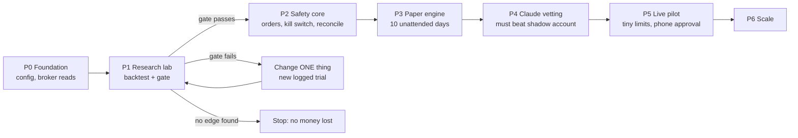
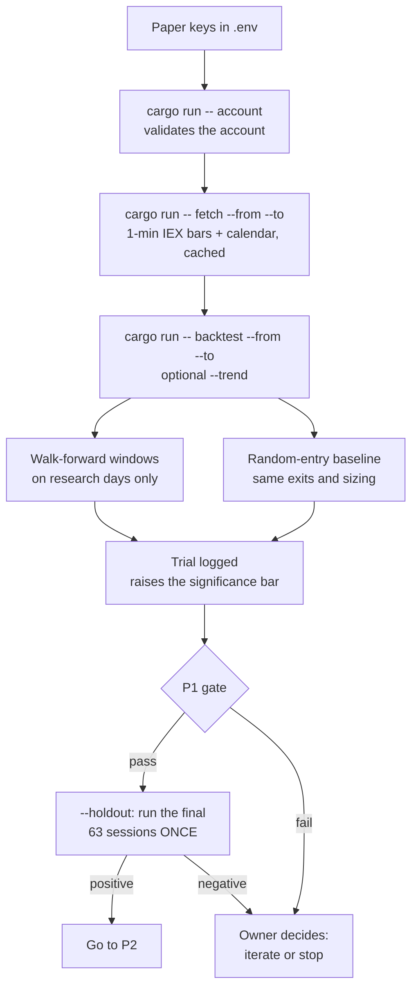
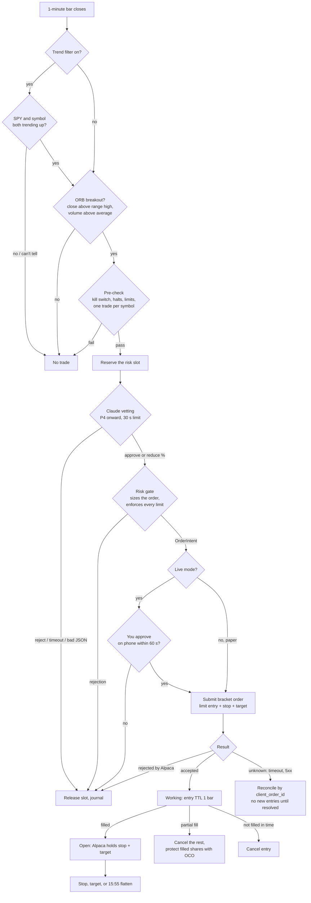

# How the flow happens

What runs, in what order, and who makes each call. The reasons are in [DECISION.md](DECISION.md);
the details are in [DESIGN.md](DESIGN.md). Diagrams are Mermaid (they render on GitHub and in VS Code).

**Who decides, in one line:** rules find the trade → Claude may veto or shrink it (from P4) →
the risk gate has the final say → Alpaca holds the stop and target.

## 1. The project flow (phases)



Where we are: **P1 code done, waiting for Alpaca paper keys** to download data and run the gate.
P2 broker code is in progress.

## 2. The research flow (P1, what you run now)



## 3. A trading day (P3 onward)

All times come from Alpaca's calendar, so half-days shift automatically.

| When (ET, normal day) | What happens | Who decides |
|---|---|---|
| 09:00 | Startup: config check, risk self-test, kill-switch test, reconcile with Alpaca. Live: you confirm the session. Any failure → no trading today | Engine |
| 09:30–09:45 | Build the opening range (first 15 one-minute bars). No trades | Engine |
| 09:45–15:30 | Each 1-minute bar: look for a breakout → the candidate flow below | Engine + Claude + risk gate |
| 15:30 | No new entries; cancel unfilled entry orders | Engine |
| 15:55 | Flatten: close everything, confirm flat | Engine |
| 15:57 | Backstop job closes anything still open, independently | Separate launchd job |
| After 16:00 | Daily summary and journal backup; free models may write the narrative | Engine (+ free models for text only) |

## 4. One candidate, end to end



**Before P4**, the Claude step is skipped: every candidate counts as approved, and the risk gate
still decides. **In P1**, this same flow runs inside the backtest with simulated fills.

## 5. Who can do what

| Actor | Can | Cannot |
|---|---|---|
| **Rules (strategy + trend filter)** | Propose a candidate with entry, stop and target | Size it or place it |
| **Claude** (P4+) | Approve, reduce 1–99%, reject | Create a trade, raise size, move prices, skip the gate |
| **Risk gate** | Size the order, refuse it | Be bypassed: it's the only way to make an `OrderIntent` |
| **Broker module** | Send a gate-approved bracket, cancel, close all | Send any other kind of buy |
| **You** | Approve live orders, STOP, flatten, flip paper ↔ live in `.env` | Place a trade from any UI (there are no buy buttons) |
| **Free models (OmniRoute)** | Summaries, digests, logs, research ideas | Anything in this flow |

## 6. When something goes wrong

| Situation | What the flow does |
|---|---|
| STOP file present, or can't be read | Halt: no new entries, cancel working entries |
| Daily loss −2%, or 3 losses in a row | Halt for the rest of the day |
| Order submit times out | Outcome "unknown": reconcile by `client_order_id` before anything else |
| Bad or stale data for a symbol with a position | Halt and flatten |
| Claude down, slow or nonsensical | That trade is rejected; 5 errors in a row stop entries for the day |
| Engine sees something it can't explain | Halt and flatten ("unknown means stop") |
| Mac sleeps or the engine crashes | Alpaca still holds every stop and target; the backstop job flattens at 15:57 |

## 7. How the engine is built (for developers)

One pure function, `engine::State::step(Event) -> Vec<Effect>`, owns all trading state. The
backtest and the live loop feed it the same events, so a backtest exercises the real decision code.

```
Events in:  SessionStart · Bar · Tick · Vetted · EntryFilled · EntryClosed · Exited · KillSwitch
Effects out: Vet · Submit · CancelEntry · FlattenAll · Journal
```

The live loop (P3) turns effects into broker calls and broker updates back into events.
